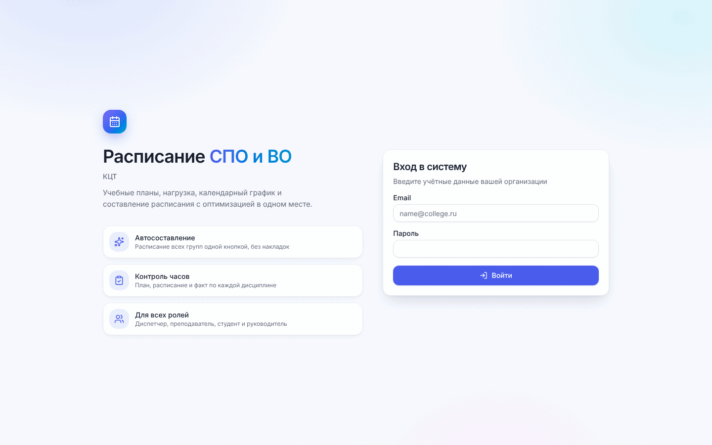
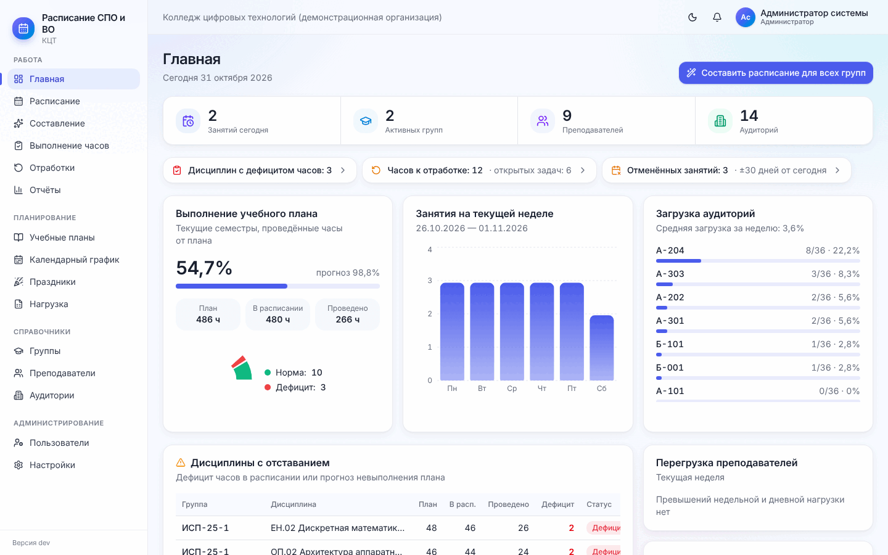

# 1. Знакомство с программой

[← Содержание](README.md) · [Далее: 2. Подготовка к работе →](02-podgotovka.md)

## 1.1. Что умеет программа

Программа хранит учебные планы колледжа (СПО) и вуза (бакалавриат, специалитет, магистратура), считает, сколько пар
нужно поставить по каждой дисциплине, и **сама составляет расписание сразу для всех групп** — так, чтобы у
преподавателей, групп и аудиторий не было накладок. Дальше она помогает вести расписание в течение семестра:
отмечать проведённые занятия, переносить, оформлять замены, ставить отработки и контролировать выполнение часов.

Основные понятия:

| Понятие | Что это |
| --- | --- |
| **Пара** | 2 академических часа (настраивается). Нечётные часы дают **неполную пару** — занятие на 1 час, оно помечено «1 ч» |
| **Учебный план** | Специальность (направление), год набора, форма обучения, семестры и дисциплины с часами |
| **Нагрузка** | Какой преподаватель ведёт какую дисциплину у какой группы (вид занятий, подгруппа) |
| **Период расписания** | Расписание одного семестра одного учебного плана. Создаётся автоматически при составлении |
| **Черновик / опубликовано** | Черновик видят только диспетчеры. После публикации расписание видят студенты и преподаватели |
| **Поток** | Пара, которую один преподаватель ведёт сразу у нескольких групп (общая лекция, физкультура) |

## 1.2. Вход

Откройте адрес программы в браузере (Chrome, Edge, Firefox, Яндекс Браузер; на телефоне тоже работает). Введите
e-mail и пароль, которые выдал администратор, и нажмите **«Войти»**.

Учётные записи создаёт администратор (раздел [2.6](02-podgotovka.md#26-пользователи-и-роли)); регистрации и
списка тестовых пользователей на странице входа нет. Название программы и логотип на странице входа, в меню и на
вкладке браузера настраиваются ([2.2](02-podgotovka.md#22-организация)).

Чтобы выйти, нажмите на своё имя в правом верхнем углу → **«Выйти»**.

## 1.3. Роли

Каждый пользователь работает в одной роли. Меню показывает только разделы, доступные роли.

| Роль | Что может |
| --- | --- |
| **Администратор** | Всё: настройки организации, пользователи, справочники, составление и публикация расписания |
| **Диспетчер** | Всё, кроме управления пользователями; настройки только просматривает |
| **Руководитель** | Просматривает расписание, справочники, выполнение часов и отчёты; ничего не меняет |
| **Преподаватель** | Своё расписание, отметка проведения своих занятий, своя доступность, отработки, отчёт по своему расписанию |
| **Студент** | Расписание своей группы, изменения и уведомления |

## 1.4. Устройство экрана

- **Меню слева** разбито на группы:
  - *Работа* — Главная, Расписание, Составление, Выполнение часов, Отработки, Отчёты;
  - *Планирование* — Учебные планы, Календарный график, Праздники, Нагрузка;
  - *Справочники* — Группы, Преподаватели, Аудитории;
  - *Администрирование* — Пользователи, Настройки.

  Пока подготовка не завершена, первым пунктом стоит **«Мастер настройки»**. На телефоне меню открывается кнопкой
  «☰» вверху слева.
- **Верхняя полоса**: название организации, переключатель светлой/тёмной темы (луна/солнце), колокольчик
  уведомлений (красная точка — есть непрочитанные), имя и роль пользователя.
- **Заголовок страницы** с кнопками главных действий справа.

Общие приёмы, одинаковые на всех страницах:

- таблицы сортируются нажатием на заголовок столбца, над таблицей есть поиск;
- фильтры-«таблетки» (например «Все / СПО / Высшее образование») переключаются одним нажатием;
- удаление всегда спрашивает подтверждение; то, что используется в расписании, удалить нельзя — программа
  предложит сделать запись неактивной;
- после сохранения в правом верхнем углу появляется короткое сообщение («Сохранено», «Период создан»…),
  ошибки показываются там же красным;
- адрес страницы расписания хранит выбранные период, вид, неделю и группу — ссылку можно отправить коллеге.

## 1.5. Главная страница

Для администратора, диспетчера и руководителя главная — это сводка дня:

- кнопка **«Составить расписание для всех групп»** (переходит в «Составление»);
- полоса чисел: занятий сегодня, активных групп, преподавателей, аудиторий;
- **«Требует внимания»** — только то, что не в порядке: конфликты, дисциплины с дефицитом часов, часы к
  отработке, отменённые занятия, перегрузка преподавателей. Нажатие ведёт в нужный раздел. Если всё хорошо,
  этих плашек нет;
- **«Выполнение учебного плана»** — доля проведённых часов текущих семестров и прогноз к концу семестра;
- **«Занятия на текущей неделе»** по дням и **«Загрузка аудиторий»**;
- **«Дисциплины с отставанием»** — таблица дисциплин, где в расписании меньше часов, чем по плану, или прогноз
  невыполнения;
- **«Перегрузка преподавателей»** и **«Периоды расписания»** (что опубликовано, что в черновике).

Что видят на главной преподаватель и студент — в разделе [10](10-prepodavatelyu-i-studentu.md).

[← Содержание](README.md) · [Далее: 2. Подготовка к работе →](02-podgotovka.md)
