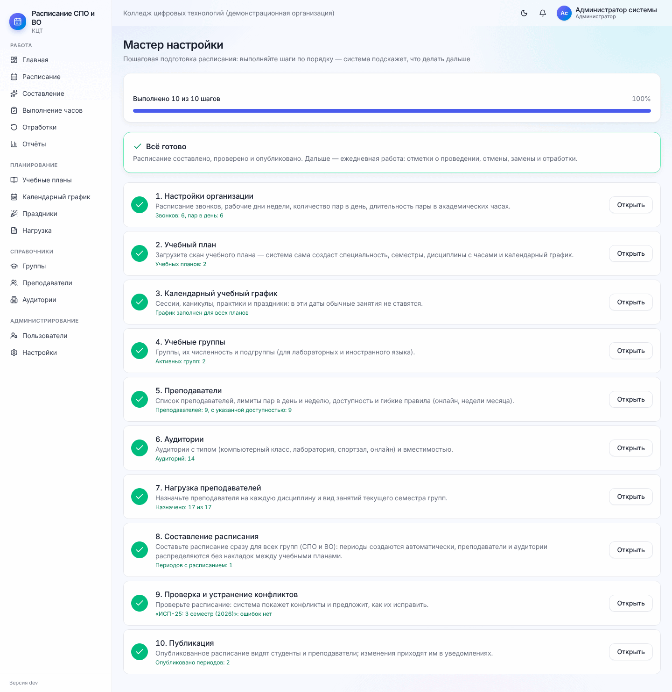
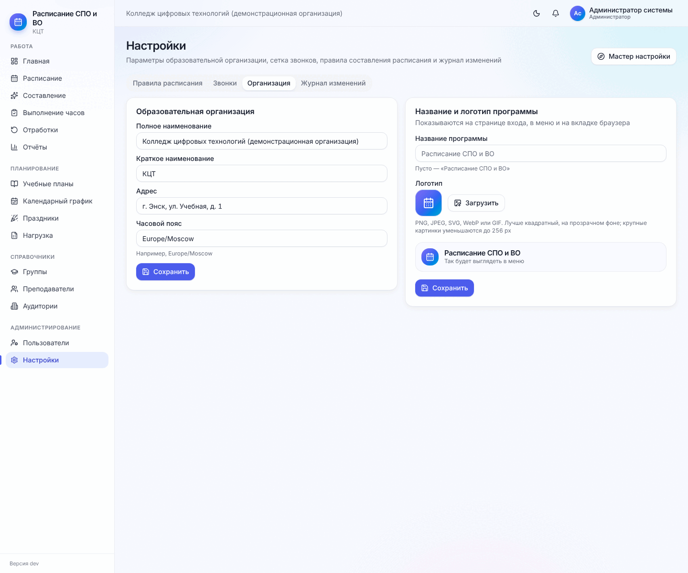
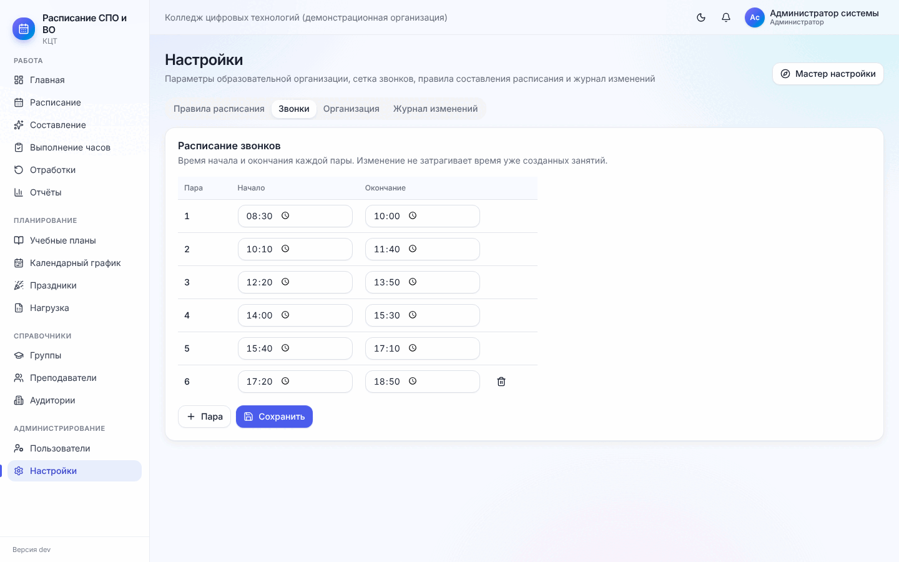
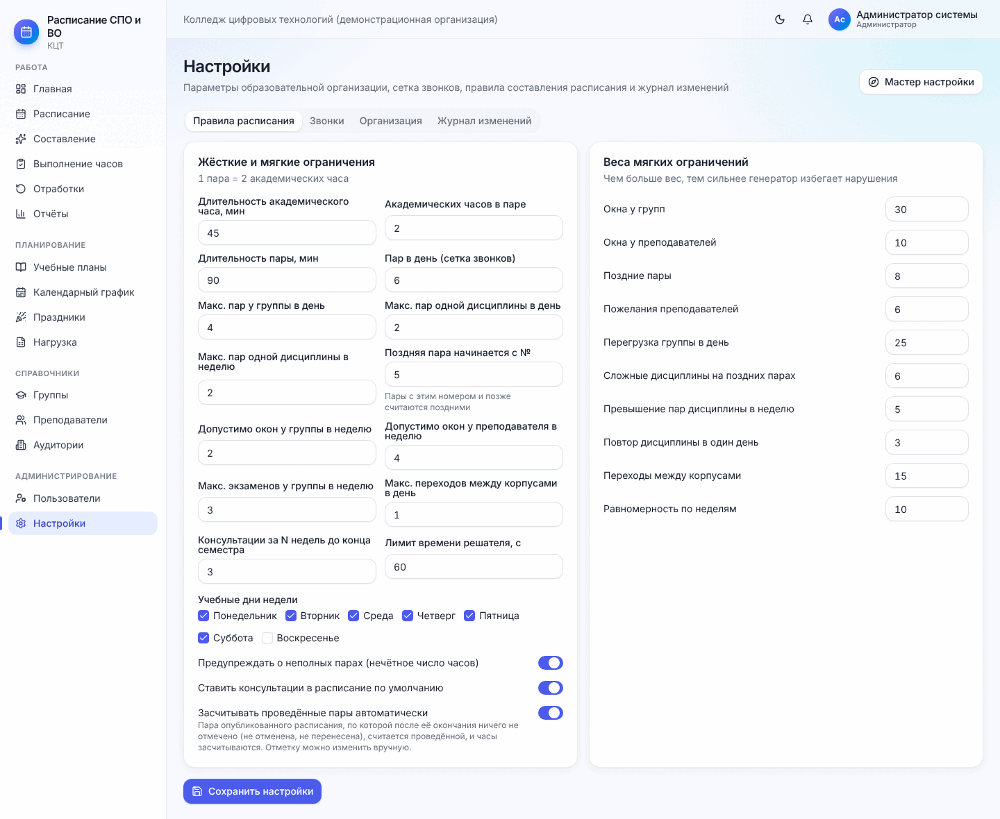
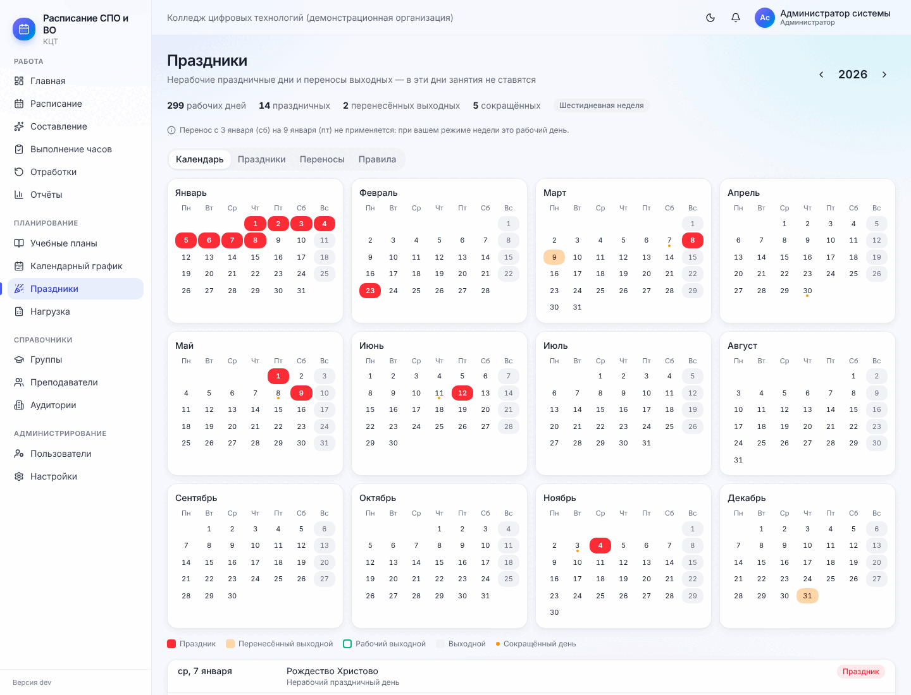
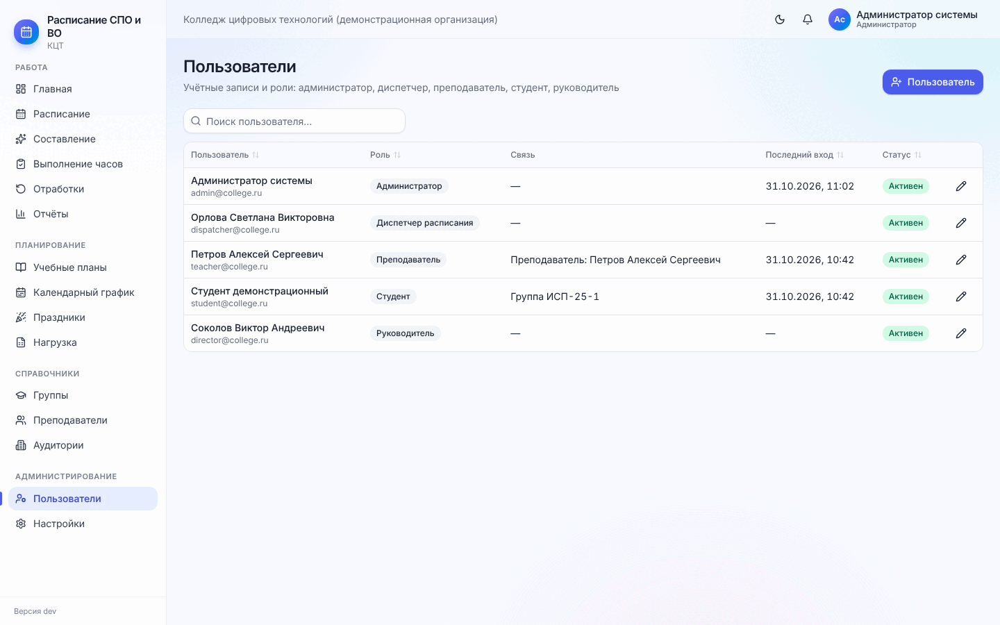

# 2. Подготовка к работе

[← 1. Знакомство](01-znakomstvo.md) · [Содержание](README.md) · [Далее: 3. Учебные планы и график →](03-plany-i-grafik.md)

Подготовку выполняет администратор (часть шагов — диспетчер) один раз перед началом учебного года. Потом к этим
настройкам возвращаются редко: при смене звонков, появлении новых праздников или сотрудников.

## 2.1. Мастер настройки

**Меню → Мастер настройки.** Десять шагов в том порядке, в котором их удобнее всего выполнять. У каждого шага —
что уже сделано (зелёным: «Звонков: 6, пар в день: 6», «Назначено: 17 из 17») и кнопка **«Открыть»**.

| Шаг | Где выполняется | Раздел методички |
| --- | --- | --- |
| 1. Настройки организации | Настройки | [2.2–2.4](#22-организация) |
| 2. Учебный план | Учебные планы | [3](03-plany-i-grafik.md) |
| 3. Календарный учебный график | Календарный график | [3.5](03-plany-i-grafik.md#35-календарный-учебный-график) |
| 4. Учебные группы | Группы | [4.1](04-spravochniki.md#41-группы) |
| 5. Преподаватели | Преподаватели | [4.2](04-spravochniki.md#42-преподаватели) |
| 6. Аудитории | Аудитории | [4.3](04-spravochniki.md#43-аудитории) |
| 7. Нагрузка преподавателей | Нагрузка | [5](05-nagruzka.md) |
| 8. Составление расписания | Составление | [6](06-sostavlenie.md) |
| 9. Проверка и устранение конфликтов | Расписание → «Проверить» | [7.4](07-raspisanie.md#74-проверка-и-устранение-конфликтов) |
| 10. Публикация | Расписание → «Опубликовать» | [7.5](07-raspisanie.md#75-публикация) |

Если открыть шаг из мастера, вверху страницы появляется подсказка «Шаг N из 10» с переходом к следующему шагу.
Когда все шаги выполнены, мастер уходит из начала меню; открыть его снова можно кнопкой **«Мастер настройки»** в
«Настройках».

## 2.2. Организация

**Настройки → вкладка «Организация».** Полное и краткое наименование, адрес, часовой пояс (например
`Europe/Moscow`). Краткое наименование показывается в меню, полное — в шапке и в печатных формах.

Справа — блок **«Название и логотип программы»**: они показываются на странице входа, в меню и на вкладке
браузера. Введите название (пусто — «Расписание СПО и ВО»), нажмите **«Загрузить»** и выберите картинку PNG,
JPEG, SVG, WebP или GIF — лучше квадратную, на прозрачном фоне; крупные картинки программа сама уменьшит до
256 px. Ниже видно, как это будет выглядеть в меню. **«Стандартный значок»** возвращает исходный логотип.
Не забудьте **«Сохранить»**.

> Изменять настройки может только администратор. Диспетчер видит их и журнал изменений, но кнопки сохранения у
> него нет.

## 2.3. Звонки

**Настройки → вкладка «Звонки».** Время начала и окончания каждой пары. **«+ Пара»** добавляет строку, корзина
справа — удаляет последнюю. Количество строк = количество пар в сетке дня.

Изменение звонков не трогает уже созданные занятия — у них сохраняется прежнее время. Поэтому звонки лучше
настроить до первого составления.

## 2.4. Правила расписания

**Настройки → вкладка «Правила расписания».** Левая колонка — ограничения, правая — «веса» пожеланий.

**Жёсткие и мягкие ограничения** (левая колонка):

| Поле | Что означает | Обычно |
| --- | --- | --- |
| Длительность академического часа, мин / Академических часов в паре / Длительность пары | Из чего складывается пара | 45 / 2 / 90 |
| Пар в день (сетка звонков) | Сколько пар в дне всего | 6 |
| Макс. пар у группы в день | Больше этого группе не ставится | 4 |
| Макс. пар одной дисциплины в день / в неделю | Чтобы дисциплина не шла «стеной» | 2 / 2–3 |
| Поздняя пара начинается с № | Пары с этим номером и позже генератор старается не ставить | 5 |
| Допустимо окон у группы / у преподавателя в неделю | «Окно» — пустая пара между занятиями | 2 / 4 |
| Макс. экзаменов у группы в неделю | Для автораспределения экзаменов | 3 |
| Макс. переходов между корпусами в день | Если корпусов несколько | 1 |
| Консультации за N недель до конца семестра | Когда ставить консультации | 3 |
| Лимит времени решателя, с | Сколько секунд генератор ищет лучший вариант | 60 |
| Учебные дни недели | Отметьте дни, в которые идут занятия (суббота — для шестидневки) | Пн–Сб |

Переключатели внизу:

- **Предупреждать о неполных парах** — при нечётном числе часов программа покажет предупреждение;
- **Ставить консультации в расписание по умолчанию**;
- **Засчитывать проведённые пары автоматически** — пара опубликованного расписания, по которой после её окончания
  никто ничего не отметил (не отменил, не перенёс), считается проведённой, и часы засчитываются. Удобно, если
  преподаватели не отмечают занятия сами; отметку всегда можно исправить вручную.

**Веса мягких ограничений** (правая колонка): чем больше число, тем сильнее генератор избегает нарушения
(окна у групп и преподавателей, поздние пары, пожелания преподавателей, перегрузка группы в день, сложные
дисциплины на поздних парах, превышение пар дисциплины в неделю, повтор дисциплины в один день, переходы между
корпусами, равномерность по неделям). Менять веса без необходимости не нужно — значения по умолчанию подобраны.
Пример: если группы жалуются на окна, увеличьте «Окна у групп» с 30 до 60.

Не забудьте нажать **«Сохранить настройки»** внизу.

## 2.5. Праздники

**Меню → Праздники.** Нерабочие праздничные дни и переносы выходных. В эти дни занятия не ставятся, а если
занятие там уже стоит, проверка расписания покажет ошибку.

- Стрелки у года переключают год. Вверху — сводка: рабочих дней, праздничных, перенесённых выходных.
- Переключатель **«Шестидневная / Пятидневная неделя»** влияет только на то, как считаются переносы (рабочие
  субботы при пятидневке показываются, но занятия в них не ставятся).
- Если вверху написано «Нерабочие дни … года ещё не добавлены в календарный график» — нажмите
  **«Добавить в график»**.
- Вкладка **«Календарь»** — год по месяцам, праздники и перенесённые выходные выделены цветом.
- Вкладка **«Праздники»** — список праздников. **«Новый праздник»**: название, вид, дата
  (каждый год или один раз — для праздников с плавающей датой, например Ураза-байрам, Курбан-байрам, их задают
  на каждый год), примечание-основание («указ Главы региона…»). Переключатель **«Переносить выходной»** — если
  праздник выпал на выходной, следующий рабочий день станет выходным (ст. 112 ТК РФ).
- Вкладка **«Переносы»** — переносы выходных по постановлению Правительства: «Выходной день (суббота или
  воскресенье) → Переносится на (этот день станет нерабочим)», основание. Добавляйте их, когда постановление на
  новый год опубликовано.
- Вкладка **«Правила»** — как программа считает праздники (ст. 112 ТК РФ, предпраздничные дни: сокращение на
  1 час на число пар не влияет).
- **«Восстановить федеральные праздники»** возвращает праздники по ТК РФ и переносы по постановлениям к значениям
  по умолчанию; свои и региональные праздники сохраняются.

После любого изменения программа сама пересчитывает календарный график всех планов.

## 2.6. Пользователи и роли

**Меню → Пользователи** (только администратор).

1. **«Новый пользователь»**: ФИО, e-mail (он же логин), роль, пароль не короче 8 символов.
2. Для роли **«Преподаватель»** выберите карточку преподавателя — тогда он увидит своё расписание и сможет
   отмечать занятия. Для роли **«Студент»** выберите группу.
3. Чтобы сменить пароль, откройте пользователя (карандаш) и введите новый пароль; пустое поле — пароль не меняется.
4. Уволившегося сотрудника **заблокируйте** — войти он не сможет, история его действий сохранится.

> Если преподаватель пишет «Учётная запись не связана с расписанием» — у его пользователя не выбрана карточка
> преподавателя. Откройте пользователя и укажите её.

## 2.7. Журнал изменений

**Настройки → «Журнал изменений»** — кто, когда и что менял: создание, перенос, отмена, замена, отметка
проведения, публикация, применение генерации, импорт, входы в систему. Фильтр по типу объекта и действию.
Пригодится, когда нужно выяснить, кто перенёс пару.

[← 1. Знакомство](01-znakomstvo.md) · [Содержание](README.md) · [Далее: 3. Учебные планы и график →](03-plany-i-grafik.md)
