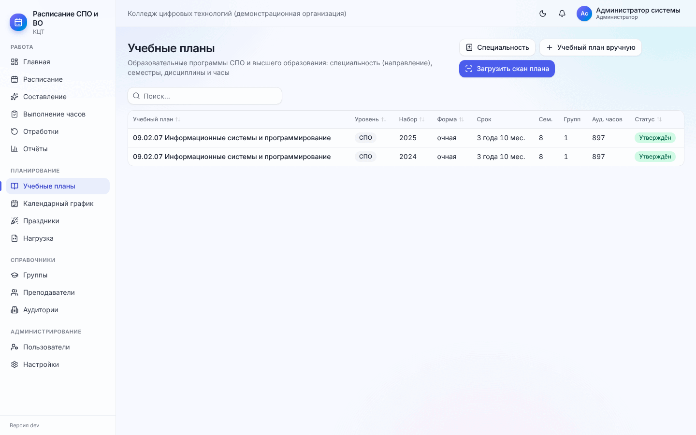
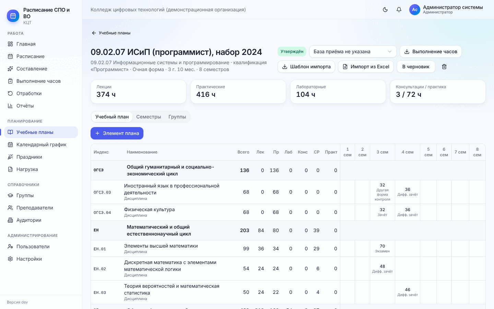
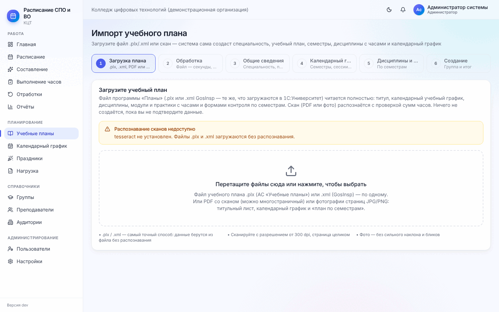
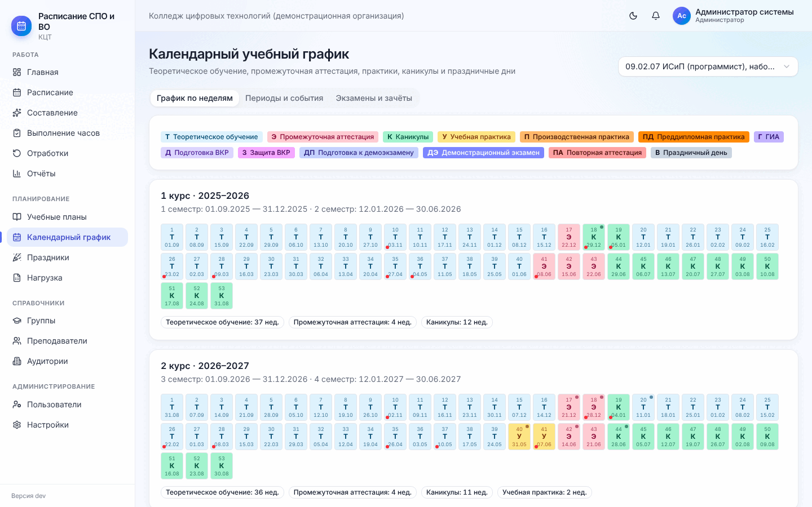
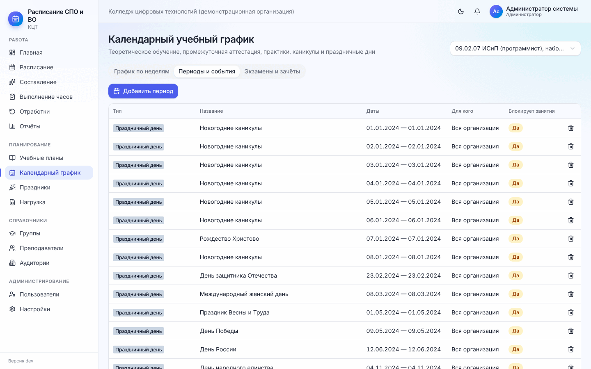
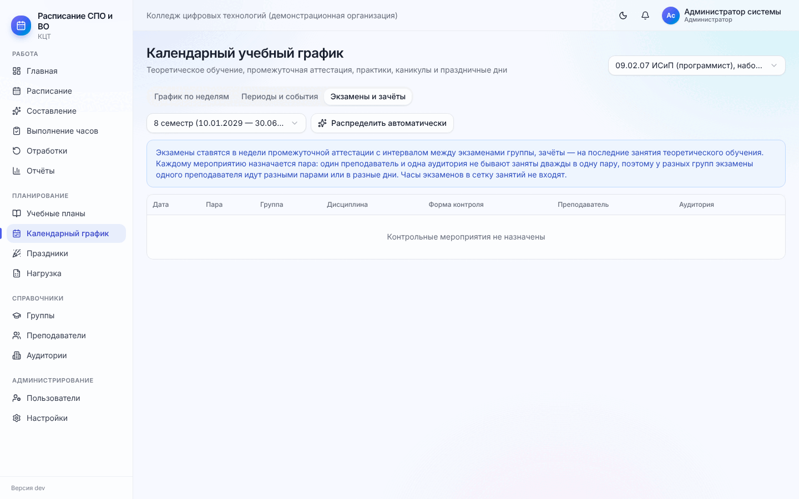

# 3. Учебные планы и календарный график

[← 2. Подготовка](02-podgotovka.md) · [Содержание](README.md) · [Далее: 4. Справочники →](04-spravochniki.md)

Учебный план — основа всего: из него программа берёт дисциплины, часы по семестрам и виды занятий. Из
календарного графика — в какие недели идёт теоретическое обучение, а в какие сессия, практика и каникулы.

## 3.1. Список учебных планов

**Меню → Учебные планы.** Таблица планов: специальность, уровень (СПО, бакалавриат…), год набора, форма
обучения, срок, число семестров и групп, аудиторных часов, статус. Фильтр **«Все / СПО / Высшее образование»**.

Кнопки справа вверху:

- **«Специальность»** — добавить специальность СПО или направление подготовки ВО: код (`09.02.07`), наименование,
  квалификация, приказ ФГОС, срок. **Уровень образования определяется по коду**: `xx.02.xx` — СПО,
  `xx.03.xx` — бакалавриат, `xx.04.xx` — магистратура, `xx.05.xx` — специалитет;
- **«Учебный план вручную»** — пустой план: специальность, название, год набора, форма обучения (очная,
  очно-заочная, заочная), база приёма (на базе 9 или 11 классов — попадает в заголовок печатной формы), срок
  обучения в месяцах (3 г. 10 мес. = 46) и число семестров;
- **«Загрузить скан плана»** — импорт из файла программы «Планы» (.plx, .xml) или со скана, самый быстрый способ, см. [3.3](#33-импорт-плана-из-файла-plx-xml-или-со-скана).

## 3.2. Карточка учебного плана

Вверху — статус (**Черновик / Утверждён**), база приёма и кнопки:

- **«Выполнение часов»** — выгрузка в Excel план/расписание/факт по всем дисциплинам плана;
- **«Шаблон импорта»** и **«Импорт из Excel»** — см. [3.4](#34-импорт-из-excel);
- **«Утвердить» / «В черновик»** — смена статуса;
- корзина — удалить план (только если к нему не привязаны группы и расписание).

Карточки с суммами: лекции, практические, лабораторные, консультации / практика.

**Вкладка «Учебный план»** — дерево по циклам (ОГСЭ, ЕН, ОП, ПМ; для ВО — Б1, Б2, Б3, ФТД): индекс, наименование,
всего часов, по видам (Лек, Пр, Лаб, Конс, СР, Практ) и по семестрам с формой контроля (экзамен, зачёт,
дифф. зачёт…).

- **«+ Элемент плана»** — новая дисциплина, МДК, профессиональный модуль, практика или цикл. Укажите цикл, вид
  элемента, индекс, наименование, кафедру/ПЦК; для МДК — модуль, в который он входит.
- Нажмите на строку, чтобы открыть **редактор часов**: часы по видам занятий в каждом семестре, форма контроля,
  признак «по выбору» (дисциплина по выбору или факультатив ставится в расписание только тем группам, которым
  назначена нагрузка).
- Там же для каждого семестра: **«Практика проводится на базе организации»** (тогда часы практики ставятся в
  расписание), **«Ставить консультации в расписание»** и **«Требуемые типы аудиторий»** по видам занятий
  (например, физкультура — «Спортивный зал»). Если тип не выбран, действуют значения по умолчанию: лекции,
  практические и консультации — лекционная или учебный кабинет; лабораторные — лаборатория или компьютерный
  класс; практика — мастерская, компьютерный класс или лаборатория.
- При нечётном числе часов появится предупреждение «Нечётное число часов» — значит, в расписании будет одна
  неполная пара (1 час). Это нормально, если так в плане.
- Самостоятельная работа, часы промежуточной аттестации и выездная практика в сетку расписания не ставятся —
  они только учитываются.

**Вкладка «Семестры»** — даты начала и окончания каждого семестра, недели теории, аттестации, практики и каникул.
Даты семестра важны: занятия ставятся только внутри них.

**Вкладка «Группы»** — группы, которые учатся по этому плану.

## 3.3. Импорт плана из файла .plx, .xml или со скана

**Учебные планы → «Загрузить скан плана».** Подходят:

- **файл .plx** из программы «Планы» (АС «Учебные планы» ММИС) или **.xml GosInsp** — те же файлы, что
  загружаются в 1С:Университет. **Это самый точный способ**: титул, календарный график, дисциплины, модули и
  практики с часами и формами контроля берутся из файла без распознавания, за секунды. Загружайте по одному
  файлу;
- **скан** (PDF, в том числе многостраничный) или **фото страниц** JPG/PNG — распознаётся примерно за минуту с
  проверкой сумм часов.

Программа сама находит титульный лист, календарный учебный график и план по семестрам и создаёт специальность, план, семестры, циклы, дисциплины с часами и формами контроля,
календарный график и (по желанию) группу. **Ничего не создаётся, пока вы не подтвердите данные.**

Шесть шагов:

1. **Загрузка плана.** Перетащите файл в рамку или нажмите на неё и нажмите **«Загрузить план»** (для .plx/.xml)
   или **«Распознать»** (для скана). Для скана нужны титульный лист, календарный график и страницы «план по
   семестрам»; советы: от 300 dpi, страница целиком, фото без наклона и бликов. Файл .plx/.xml загружается
   отдельно от других файлов.
2. **Обработка** — файл читается за секунды, скан распознаётся около минуты. Страницу можно закрыть: загрузка
   останется в списке «Загруженные ранее» (там же видно, откуда данные — «Файл .plx (АС «Учебные планы»)» или
   «Файл .xml (GosInsp)», сколько строк плана и замечаний).
3. **Общие сведения** — код и наименование специальности, уровень (определяется по коду), квалификация, приказ
   ФГОС, название плана, год начала подготовки, форма и срок обучения, число семестров.
4. **Календарный график** — сетка недель по курсам. Нераспознанные клетки красные со знаком «?». Выберите
   обозначение справа («кисть») и нажмите на клетку или протяните по нескольким. При наведении на клетку виден
   фрагмент скана. Ниже — даты семестров и периоды графика.
5. **Дисциплины и часы** — таблица по семестрам. *Жёлтым* подсвечены ячейки, исправленные по сумме часов,
   *красным* — сомнительные: сверьте их со сканом (фрагмент — при наведении). Фильтр «Требуют внимания» оставляет
   только такие строки. Галочка «Импортировать» убирает лишние строки. Отметьте «по выбору» для дисциплин по
   выбору и факультативов.
6. **Создание** — итог: сколько будет создано лет, семестров, периодов, циклов, дисциплин. Если суммы часов
   где-то не сходятся, программа предупредит (можно продолжить или вернуться к шагу 5). Здесь же можно **сразу
   создать группу**: код группы, число студентов и подгрупп (курс и семестр определятся по текущей дате).

После создания откроется план — всё можно поправить вручную. План создаётся в статусе «Черновик».

> Распознавание сканов требует установленного на сервере модуля распознавания (Tesseract). Если вверху написано
> «Распознавание сканов недоступно», файлы .plx и .xml всё равно загружаются — распознавание им не нужно.
> Если не удалось прочитать файл, проверьте, что это выгрузка из «Планов» (.plx) или GosInsp (.xml).

## 3.4. Импорт из Excel

В карточке плана: **«Шаблон импорта»** скачивает файл Excel с нужными столбцами. Заполните его (индекс,
наименование, вид элемента, цикл, часы по видам занятий и семестрам, форма контроля) и загрузите кнопкой
**«Импорт из Excel»**. Существующие элементы с тем же индексом обновятся, новые добавятся.

## 3.5. Календарный учебный график

**Меню → Календарный график.** Справа вверху выберите учебный план.

**Вкладка «График по неделям».** Для каждого курса — 52–53 недели с буквенными обозначениями:

| Буква | Тип недели | Ставятся ли обычные занятия |
| --- | --- | --- |
| Т | Теоретическое обучение | Да |
| Э | Промежуточная аттестация | Нет (экзамены — отдельно) |
| К | Каникулы | Нет |
| У | Учебная практика | Только если практика на базе организации |
| П / ПД | Производственная / преддипломная практика | Нет |
| Г, Д, З, ДП, ДЭ | ГИА, подготовка и защита ВКР, демоэкзамен | Нет |
| ПА | Повторная аттестация | Нет |
| В | Праздничный день | Нет |

Чтобы изменить тип недели, **нажмите на неделю** и выберите тип из списка; «Очистить неделю» убирает отметку.
Красная точка на неделе — в ней есть праздники. Под каждым курсом — итог: сколько недель теории, аттестации,
каникул, практик.

**Вкладка «Периоды и события»** — то же самое в виде списка дат, плюс отдельные события:

**«Добавить период»**: тип, название, даты «с — по», область действия:

- вся программа, отдельный курс или отдельная группа (например, практика только у одной группы);
- вся организация — праздник или день здоровья для всех;
- преподаватель — отпуск, командировка (удобнее оформлять в карточке преподавателя, см.
  [4.2](04-spravochniki.md#42-преподаватели)).

Столбец «Блокирует занятия» показывает, будут ли в эти дни ставиться обычные пары.

**Вкладка «Экзамены и зачёты»** — контрольные мероприятия семестра.

Выберите семестр и нажмите **«Распределить автоматически»**. Экзамены ставятся в недели промежуточной аттестации
с интервалом между экзаменами группы, зачёты — на последние занятия теоретического обучения. Каждому мероприятию
назначается пара, преподаватель и аудитория без накладок. **«Перераспределить заново»** удаляет все мероприятия
семестра и расставляет их снова. Отдельное мероприятие удаляется корзиной в строке.

[← 2. Подготовка](02-podgotovka.md) · [Содержание](README.md) · [Далее: 4. Справочники →](04-spravochniki.md)
