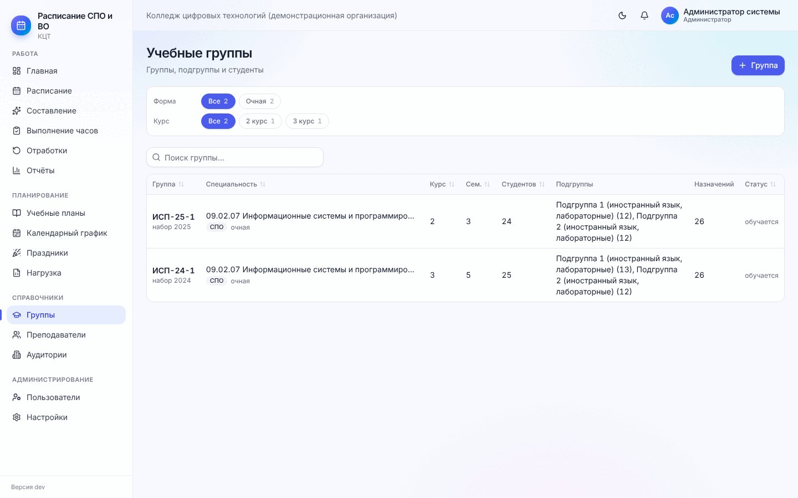
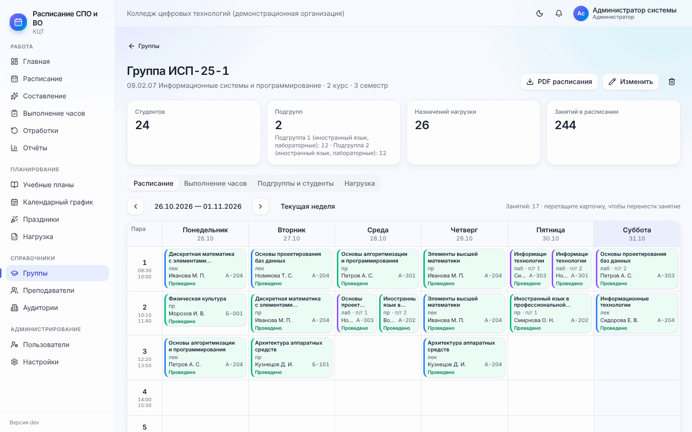
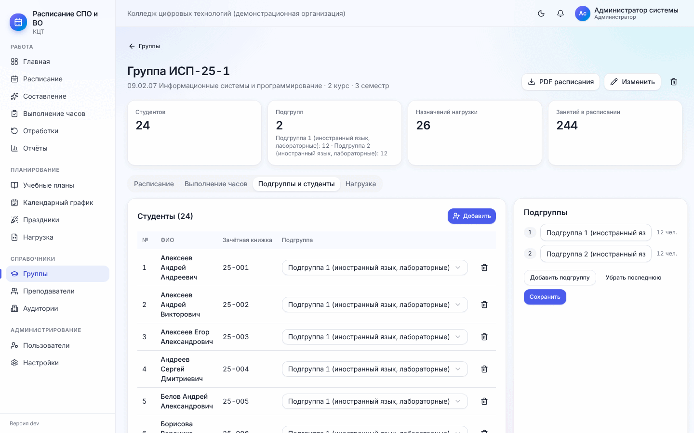
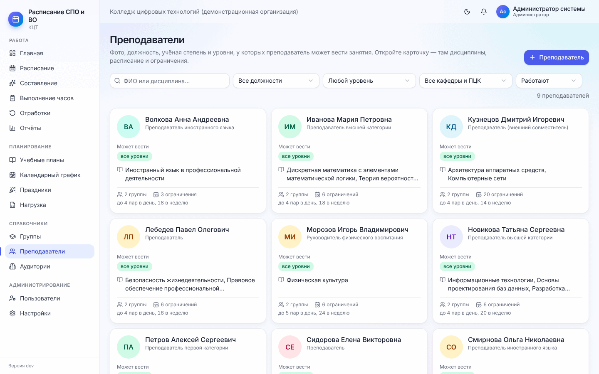
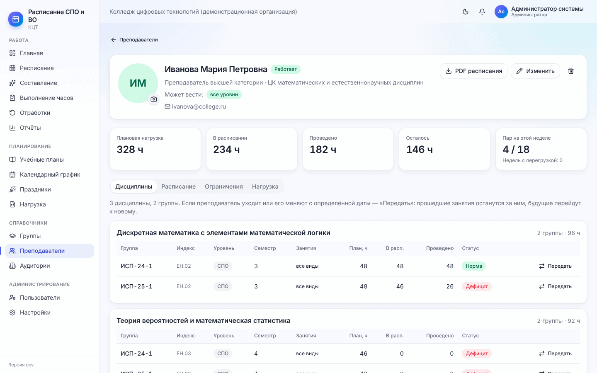
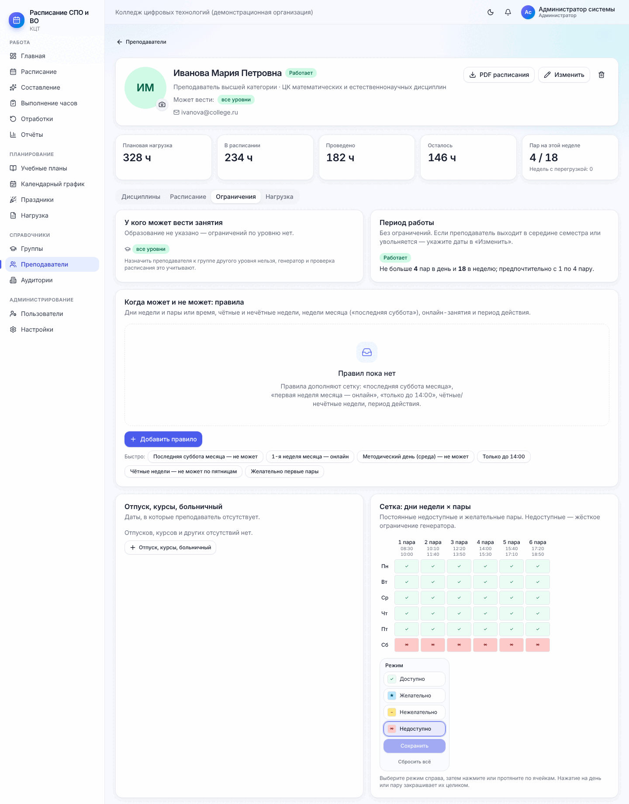
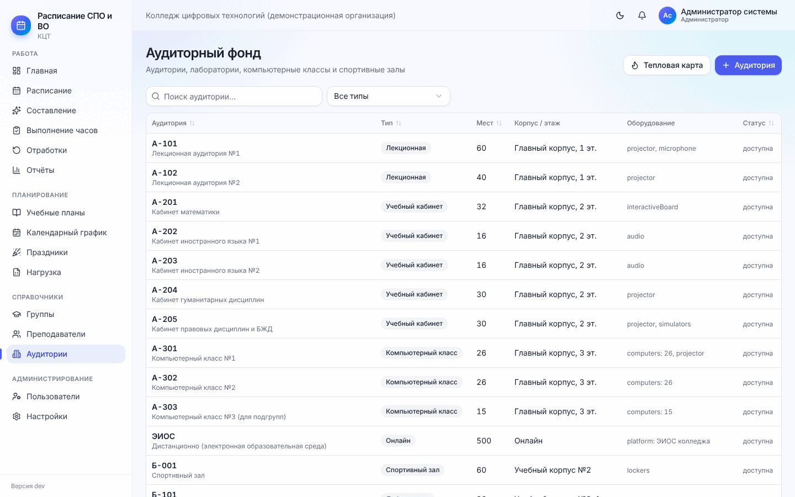
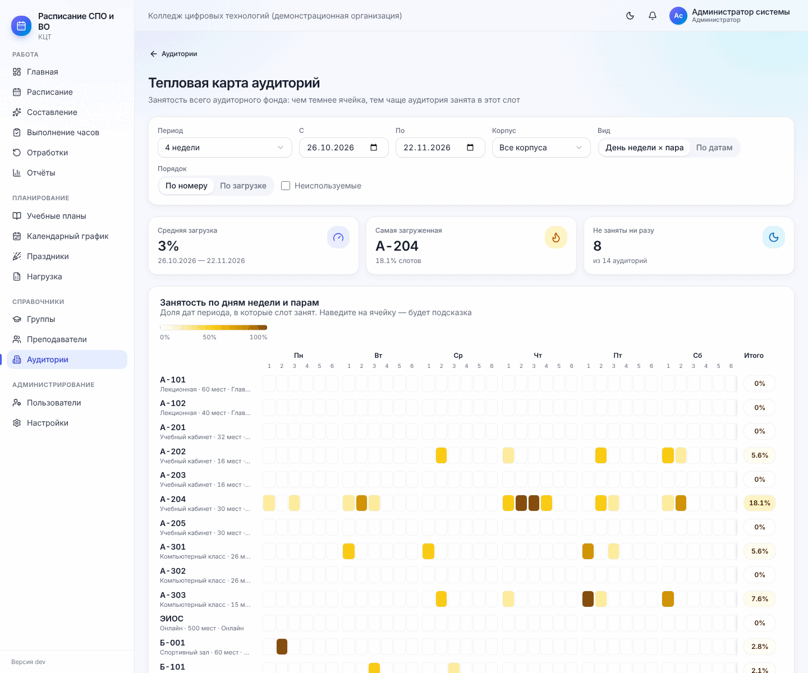
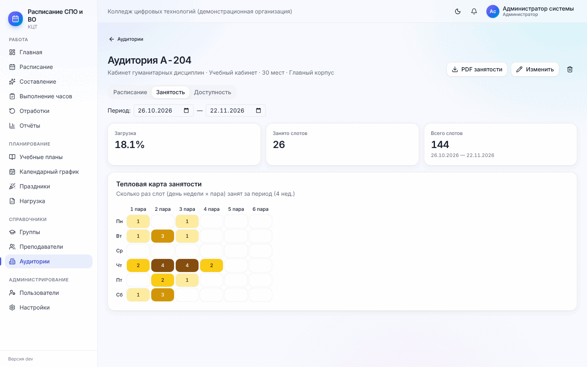

# 4. Справочники: группы, преподаватели, аудитории

[← 3. Учебные планы](03-plany-i-grafik.md) · [Содержание](README.md) · [Далее: 5. Нагрузка →](05-nagruzka.md)

## 4.1. Группы

**Меню → Группы.** Список групп: шифр и год набора, специальность, курс, семестр, численность, подгруппы, число
назначений нагрузки, статус. Фильтры: форма обучения, уровень, «Обучаются / Выпуск, архив», поиск.

**«+ Группа»** открывает форму:

| Поле | Что указать |
| --- | --- |
| Учебный план | По какому плану учится группа |
| Шифр | Например `ИСП-24-1` — так группа будет называться везде |
| Наименование | Необязательно |
| Курс, текущий семестр | Номер курса (до 7) и семестра (до 14) |
| Численность | Число студентов — по нему подбирается вместимость аудитории |
| Подгрупп | 0–4. Для лабораторных и иностранного языка |
| Режим занятий | Учебные дни группы и пары «с … по …». Например, вторая смена — с 4 по 6 пару; вечерняя очно-заочная группа — только 5–6 пары. Генератор и проверка это учитывают |

**Карточка группы** — числа (студенты, подгруппы, назначения, занятия в расписании) и вкладки:

- **Расписание** — неделя группы; занятия можно перетаскивать прямо здесь;
- **Выполнение часов** — по каждой дисциплине: план, в расписании, проведено, осталось, дефицит, процент;
- **Подгруппы и студенты** — список студентов с номером зачётной книжки и подгруппой. **«Добавить»**: вставьте
  ФИО по одному в строке — студенты распределятся по подгруппам по очереди. Подгруппу студента можно сменить
  в строке; справа — названия подгрупп (например «Подгруппа 1 (иностранный язык, лабораторные)»);
- **Нагрузка** — кто ведёт дисциплины группы (подробно — в [разделе 5](05-nagruzka.md)).

Группу, у которой уже есть занятия в расписании, удалить нельзя — так сохраняется история. Выпустившиеся группы
показываются под фильтром «Выпуск / архив».

## 4.2. Преподаватели

**Меню → Преподаватели.** Плитки с фото (или инициалами), ФИО, должностью, тем, у каких уровней может вести, и
дисциплинами. Поиск по ФИО и дисциплине, фильтры по должности, уровню, кафедре/ПЦК и статусу («Работают / Не
активные / Все»).

### Новый преподаватель

**«+ Преподаватель»**:

- **ФИО** полностью, e-mail, телефон;
- **должность** — выберите из списка (ассистент, преподаватель, старший преподаватель, доцент, профессор,
  заведующий кафедрой, мастер производственного обучения) или введите свою; кафедра / ПЦК;
- **образование, учёная степень и звание** — от них зависит, **у каких групп преподаватель может вести**:

  | Образование / степень | Может вести |
  | --- | --- |
  | Бакалавр | СПО |
  | Магистр | СПО и бакалавриат |
  | Специалист | СПО, бакалавриат, специалитет |
  | Высшая квалификация, кандидат или доктор наук, доцент или профессор | Все уровни |
  | Не указано | Без ограничений |

  Уровни можно отметить и вручную. Назначить преподавателя к группе «чужого» уровня программа не даст;
- **Работает с / по** — если преподаватель вышел в середине семестра или увольняется: вне этих дат занятия не
  ставятся;
- **Макс. пар в неделю / в день**, **предпочтительно с … по … пару**.

### Карточка преподавателя

Вверху — фото (значок камеры — загрузить JPEG/PNG/WebP до 3 МБ), должность, «Может вести», учётная запись;
кнопки **«PDF расписания»**, **«Изменить»**, удалить. Ниже — плановая нагрузка, в расписании, проведено, осталось,
пар на этой неделе и число недель с перегрузкой.

Вкладки:

- **Дисциплины** — по каждой дисциплине группы с часами и статусом. Кнопка **«Передать»** — смена преподавателя
  с даты (см. [8.6](08-ezhednevnaya-rabota.md#86-смена-преподавателя-в-середине-семестра));
- **Расписание** — неделя преподавателя;
- **Ограничения** — всё, что влияет на то, когда ему ставить пары (ниже);
- **Нагрузка** — график пар по неделям с красной линией недельного лимита и таблица по видам занятий.

### Ограничения преподавателя

1. **У кого может вести занятия** — уровни образования (см. таблицу выше).
2. **Период работы** и лимиты: «Не больше 4 пар в день и 18 в неделю; предпочтительно с 1 по 4 пару».
3. **Сетка «дни недели × пары»** — постоянные пожелания. Справа выберите режим «кисти»:

   | Режим | Значение |
   | --- | --- |
   | ✓ Доступно | Можно ставить занятия |
   | ★ Желательно | Генератор старается ставить сюда |
   | − Нежелательно | Ставится, только если иначе никак |
   | ✕ Недоступно | Жёсткий запрет — сюда занятия не ставятся никогда |

   Затем нажимайте на ячейки или протягивайте по ним; нажатие на название дня или номер пары закрашивает их
   целиком. Не забудьте **«Сохранить»**. «Сбросить всё» — вернуть «доступно» везде.
4. **Когда может и не может: правила** — для того, что не укладывается в сетку. **«Добавить правило»**:
   - что означает правило: *не может*, *может только*, *желательно*, *нежелательно*, *онлайн* (занятия в это
     время ставятся в онлайн-аудиторию);
   - дни недели; **неделя месяца** (1-я…5-я, последняя: «последняя + суббота» = «последняя суббота месяца»);
   - **чётность недели** (неделя 1 — та, в которую входит 1 сентября);
   - время: номера пар или интервал времени («только до 14:00»);
   - период действия «с … по …» и комментарий («работа в другой организации»).

   Внизу формы — «Ближайшие даты», на которые попадает правило: удобно проверить, что задумано именно это.
   Кнопки «Быстро» добавляют готовые правила: «Последняя суббота месяца — не может», «1-я неделя месяца —
   онлайн», «Методический день (среда) — не может», «Только до 14:00», «Чётные недели — не может по пятницам»,
   «Желательно первые пары».
5. **Отпуск, курсы, больничный** — см. [8.5](08-ezhednevnaya-rabota.md#85-отпуск-больничный-курсы-преподавателя).

Правила и сетка учитываются при составлении, при ручной правке и при проверке расписания. Преподаватель может
указать свою доступность сам (раздел [10](10-prepodavatelyu-i-studentu.md)).

## 4.3. Аудитории

**Меню → Аудитории.** Аудиторный фонд: номер и название, тип, мест, корпус/этаж, оборудование, статус. Фильтр по
типу, поиск.

**«+ Аудитория»**: номер, наименование, **тип**, число мест, корпус и этаж, оборудование через запятую
(«компьютеры: 25, проектор»). Типы:

| Тип | Для чего |
| --- | --- |
| Лекционная, Учебный кабинет | Лекции, практические, консультации |
| Компьютерный класс, Лаборатория | Лабораторные |
| Мастерская | Практика на базе организации |
| Спортивный зал | Физкультура (укажите этот тип у дисциплины в учебном плане) |
| Онлайн | Дистанционные занятия: вместимость не ограничена, может быть занята несколькими парами сразу |

### Тепловая карта аудиторий

Кнопка **«Тепловая карта»** на странице «Аудитории» показывает занятость **всего** аудиторного фонда: чем темнее
(от белого к тёмно-жёлтому) ячейка, тем чаще аудитория занята в этот слот.

- **Период**: эта неделя, 4 недели или свой период «с … по …»;
- **Корпус** — все или один;
- **Вид**: «День недели × пара» (сколько раз за период занят слот) или «По датам»;
- **Порядок**: по номеру или по загрузке (самые загруженные сверху); галочка показывает и неиспользуемые
  аудитории;
- сверху — средняя загрузка, самая загруженная аудитория и сколько аудиторий не заняты ни разу. Наведите на
  ячейку — будет подсказка с числами.

Карта помогает найти свободные аудитории для переноса и понять, хватает ли фонда: если почти все строки тёмные в
первых парах, а генератор пишет «Не хватает аудиторий», — аудиторий действительно мало.

**Карточка аудитории**: вкладки **Расписание**, **Занятость** (тепловая карта: сколько раз каждая пара каждого
дня недели занята за период — сразу видно свободные окна) и **Доступность** (недоступные слоты — ремонт,
мероприятия; генератор их не использует).

Аудиторию, в которой уже есть занятия, удалить нельзя — отметьте её как «Не используется».

[← 3. Учебные планы](03-plany-i-grafik.md) · [Содержание](README.md) · [Далее: 5. Нагрузка →](05-nagruzka.md)
