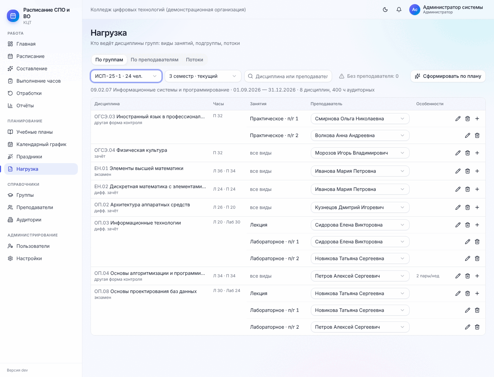
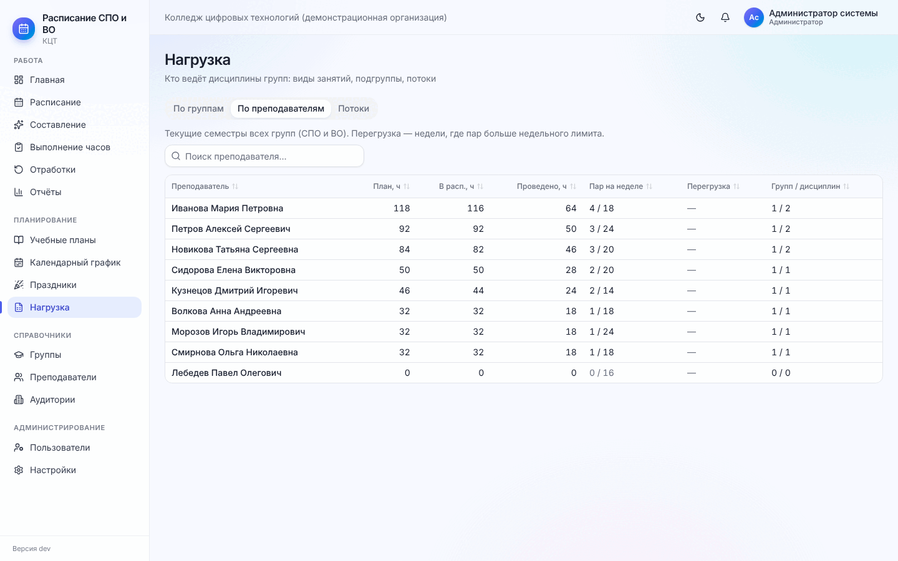
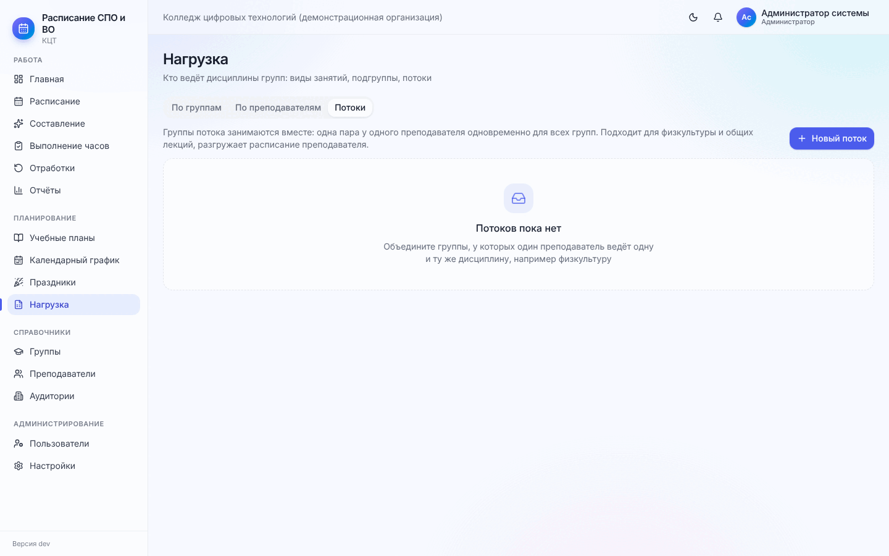

# 5. Нагрузка

[← 4. Справочники](04-spravochniki.md) · [Содержание](README.md) · [Далее: 6. Составление расписания →](06-sostavlenie.md)

Нагрузка отвечает на вопрос «кто ведёт». Без назначенного преподавателя дисциплина в расписание **не ставится**
(в результате составления она попадёт в «Не поставлено» с причиной «Преподаватель не назначен»).

**Меню → Нагрузка.** Три вкладки: «По группам», «По преподавателям», «Потоки».

## 5.1. По группам

1. Выберите **группу** (рядом указана численность) и **семестр** — по умолчанию текущий.
2. Если назначений ещё нет, нажмите **«Сформировать по плану»** — программа создаст строку на каждую дисциплину
   семестра с аудиторными часами. Остаётся выбрать преподавателей.
3. В каждой строке: дисциплина и форма контроля, часы (Л — лекции, П — практические, Лаб — лабораторные),
   занятия (вид, подгруппа; «все виды» — один преподаватель ведёт всё), **преподаватель — выбирается прямо в
   строке**. В списке только те, кто может вести у групп этого уровня образования.
4. Счётчик **«Без преподавателя: N»** сверху — нажмите, чтобы оставить только такие строки. Добейтесь нуля.

Кнопки справа в строке:

- **«+» (Разделить)** — добавить отдельное назначение на вид занятий или подгруппу. Пример: лекции по
  «Информационным технологиям» ведёт Сидорова, лабораторные подгруппы 1 — тоже Сидорова, подгруппы 2 — Новикова.
  Тогда у дисциплины три строки: «Лекция», «Лабораторное · п/г 1», «Лабораторное · п/г 2»;
- **карандаш (Изменить назначение)** — дополнительные параметры:

  | Параметр | Зачем |
  | --- | --- |
  | Вид занятий | «Все виды» или конкретный вид |
  | Подгруппа | Вся группа или подгруппа (для лабораторных и иностранного языка) |
  | Пар в неделю | Темп. Пусто — рассчитать автоматически по часам и неделям. Пример: «2 пары/нед» |
  | Приоритет | Больше — ставится раньше (для «трудных» дисциплин) |
  | Предпочтительная аудитория | Например, свой кабинет преподавателя |
  | Поток | Одинаковое название у групп одного преподавателя — общая пара (см. 5.3) |

- **корзина** — удалить назначение.

В столбце «Особенности» видно, что задано: темп, поток, аудитория, разрешённое превышение часов.

## 5.2. По преподавателям

Сводка за текущие семестры всех групп (СПО и ВО): план, в расписании, проведено, замены (ч), **пар на неделе /
лимит**, **недели с перегрузкой** (где пар больше недельного лимита), число групп и дисциплин. Поиск по ФИО.
Если у кого-то перегрузка — передайте часть дисциплин другому преподавателю или увеличьте лимит в карточке.

> На большой базе (десятки преподавателей и сотни назначений) эта вкладка открывается несколько секунд — это
> нормально.

## 5.3. Потоки

Поток — пара, которую один преподаватель ведёт **одновременно у нескольких групп**: общая лекция, физкультура,
иностранный язык смешанной подгруппы. Генератор ставит её всем группам в одно время в одну аудиторию, а при
переносе пара потока переезжает целиком.

**«Новый поток»**: выберите преподавателя и отметьте группы (точнее, назначения групп), у которых он ведёт пару
одновременно, дайте название («Физкультура 2 курс»). Выбрать одну группу дважды нельзя. В карточке потока
видно общее число студентов — убедитесь, что есть аудитория такой вместимости.

**«Расформировать»** — группы снова будут заниматься отдельно. Уже поставленные пары останутся; изменения
появятся после следующего составления.

[← 4. Справочники](04-spravochniki.md) · [Содержание](README.md) · [Далее: 6. Составление расписания →](06-sostavlenie.md)
