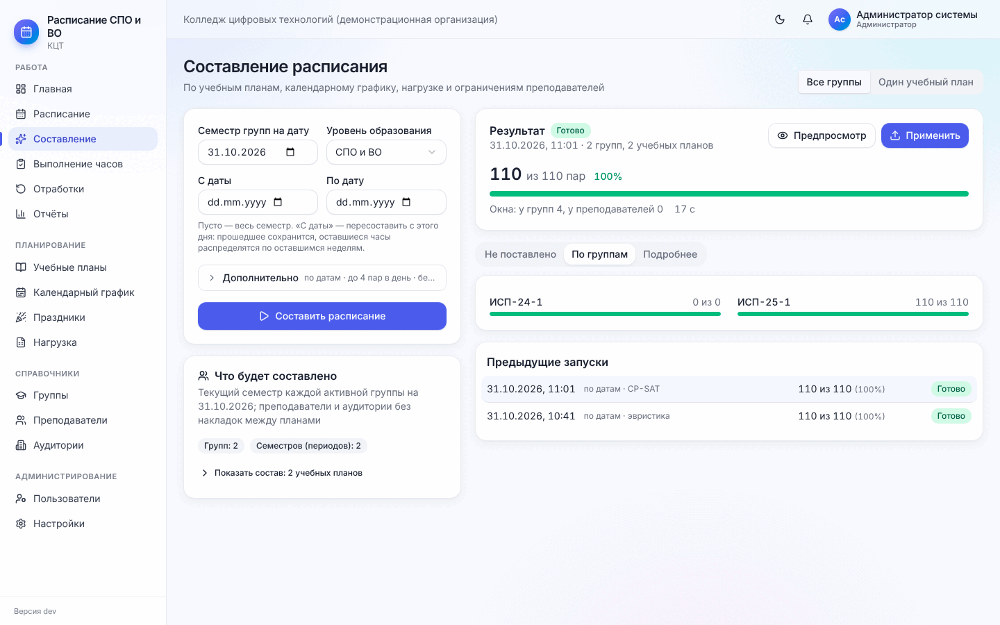
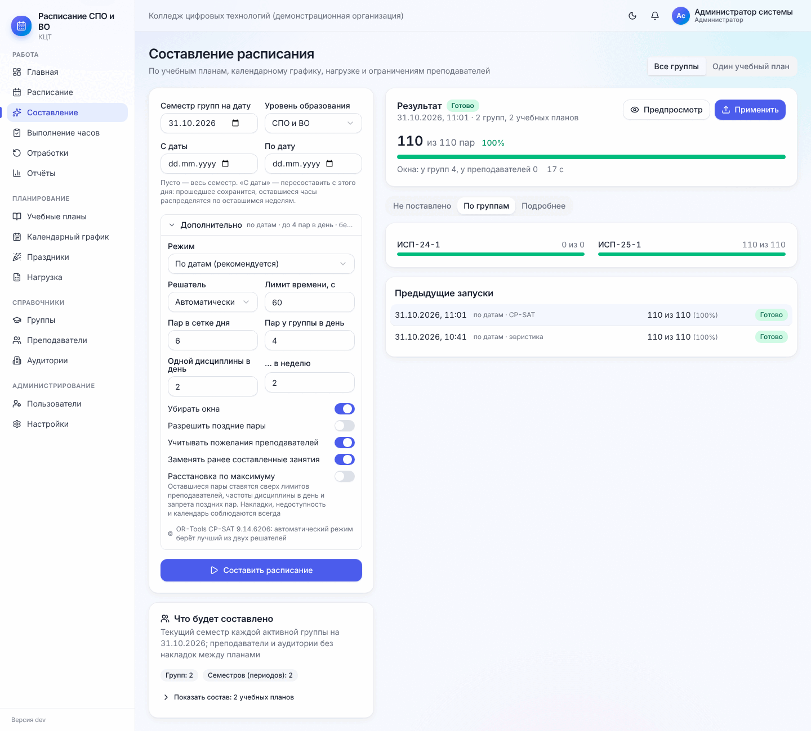
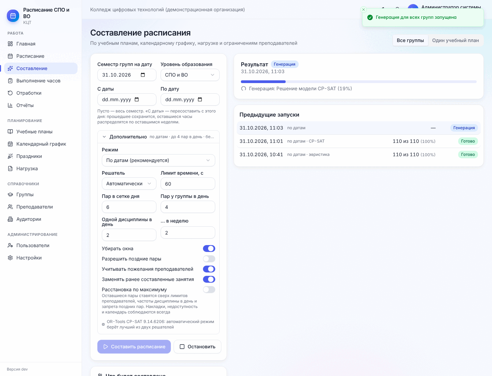
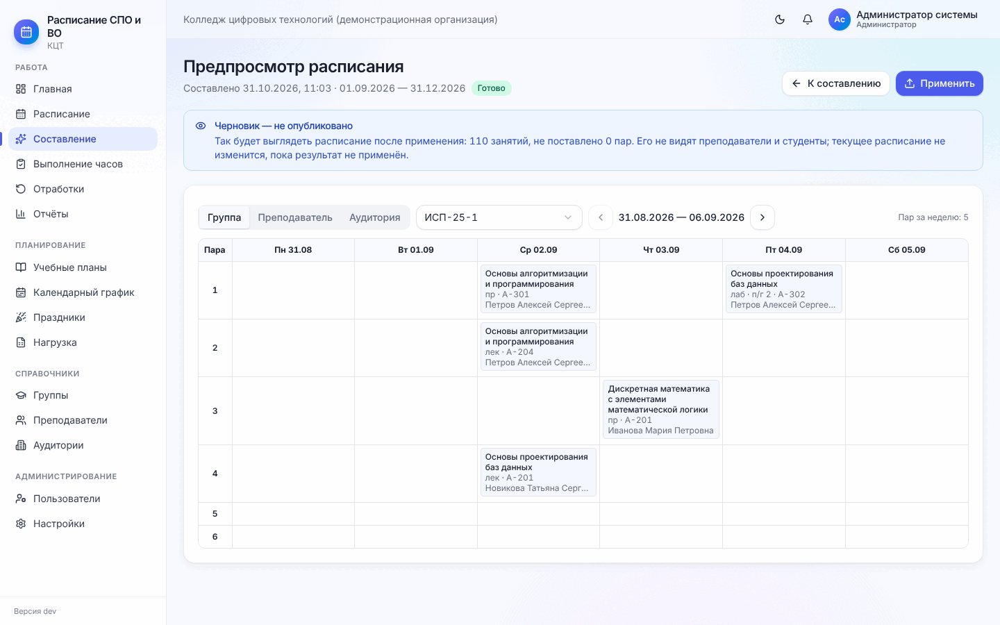

# 6. Составление расписания

[← 5. Нагрузка](05-nagruzka.md) · [Содержание](README.md) · [Далее: 7. Работа с расписанием →](07-raspisanie.md)

Программа составляет расписание **сразу для всех групп** (СПО и ВО) одной задачей, поэтому у общих
преподавателей и аудиторий не бывает накладок между планами. Составление ничего не меняет, пока вы не нажмёте
**«Применить»**: сначала можно посмотреть результат.

## 6.1. Перед запуском — короткий чек-лист

- [ ] звонки и учебные дни настроены ([2.3–2.4](02-podgotovka.md#23-звонки));
- [ ] у каждого плана заполнены семестры и календарный график, праздники добавлены в график ([3.5](03-plany-i-grafik.md#35-календарный-учебный-график));
- [ ] у групп указаны текущий семестр и численность ([4.1](04-spravochniki.md#41-группы));
- [ ] в нагрузке «Без преподавателя: 0» ([5.1](05-nagruzka.md#51-по-группам));
- [ ] аудиторий нужных типов достаточно (лабораторные — в лабораториях и компьютерных классах, физкультура — в
      спортзале) ([4.3](04-spravochniki.md#43-аудитории));
- [ ] недоступность преподавателей отмечена ([4.2](04-spravochniki.md#ограничения-преподавателя)).

Мастер настройки показывает, какие из этих пунктов не выполнены.

## 6.2. Запуск

**Меню → Составление** (или кнопка «Составить расписание для всех групп» на главной).

Режим **«Все группы»** (по умолчанию):

| Поле | Что значит |
| --- | --- |
| Семестр групп на дату | Для каждой группы берётся семестр, который идёт в эту дату (обычно — сегодня) |
| Уровень образования | СПО и ВО / только СПО / только ВО |
| С даты / По дату | Пусто — весь семестр. **«С даты»** — пересоставить с этого дня: прошедшее сохранится, оставшиеся часы распределятся по оставшимся неделям |

Справа — блок **«Что будет составлено»**: сколько групп и семестров войдёт, сколько периодов расписания будет
создано автоматически, какие группы пропущены и почему. «Показать состав» раскрывает список по учебным планам.

**«Дополнительно»** (свёрнуто, сводка видна в заголовке):

| Параметр | Рекомендация |
| --- | --- |
| Режим | **«По датам (рекомендуется)»** — учитывает праздники, практики и каникулы каждой недели. «Одинаковая неделя на весь семестр» — один шаблон недели |
| Решатель | «Автоматически» — берёт лучший из двух алгоритмов. «Эвристика (быстро)» — быстрее, чуть хуже качество |
| Лимит времени, с | Сколько секунд искать. Для большого колледжа — 60–120 |
| Пар в сетке дня, пар у группы в день, одной дисциплины в день / в неделю | Берутся из настроек; здесь можно изменить для одного запуска |
| Убирать окна | Стараться ставить пары без пропусков |
| Разрешить поздние пары | Использовать последние пары дня |
| Учитывать пожелания преподавателей | «Желательно / нежелательно» из сетки и правил (запреты учитываются всегда) |
| Заменять ранее составленные занятия | Включено — старый черновик заменяется новым. Ручные, закреплённые и проведённые занятия сохраняются всегда |
| Расстановка по максимуму | Оставшиеся пары ставятся сверх лимитов преподавателя, частоты дисциплины и запрета поздних пар. Накладки, недоступность и календарь соблюдаются всегда |

Нажмите **«Составить расписание»**. Идёт прогресс; страницу можно не держать открытой — результат сохранится в
«Предыдущих запусках». На колледже из 60 групп составление занимает 1–3 минуты.

Режим **«Один учебный план»** (переключатель вверху справа) — составить расписание только одного периода:
выберите период (или **«Новый период»**: семестр, название, даты), при необходимости — отдельные группы плана.
Там же блок **«Хватит ли времени на план»**: по каждой группе «Хватает / Плотно / Не хватает» — если не
хватает, учебных недель меньше, чем нужно для часов плана.

## 6.3. Результат

- **«N из M пар»** и процент — сколько поставлено. Зелёная полоса — всё поставлено, оранжевая — есть
  непоставленные;
- одной строкой: **не поставлено**, **окна** у групп и преподавателей, время работы;
- статус: «Готово», «Есть конфликты» (поставлено не всё или есть замечания), «Применено».

Вкладки:

- **Не поставлено** — главное, что нужно разобрать (6.4);
- **По группам** — полоса «поставлено из нужного» по каждой группе;
- **Подробнее** — нарушения пожеланий (окна, поздние пары, перегруженные дни, переходы между корпусами),
  предупреждения и журнал работы.

**«Предпросмотр»** открывает получившееся расписание по группам, преподавателям и аудиториям **до применения** —
неделя за неделей, с пометкой «Черновик — не опубликовано».

## 6.4. «Не поставлено»: что делать

Непоставленные пары сгруппированы **по причинам**, внутри — по преподавателям (раскройте строку, чтобы увидеть
дисциплины и группы; значок справа открывает карточку преподавателя или нагрузку группы). У каждой причины —
подсказка и кнопки **«Быстрые исправления»**:

| Причина | Что сделать |
| --- | --- |
| Не назначен преподаватель | Нагрузка → назначить преподавателя |
| Преподаватель неактивен / не работает в эти даты / не может вести у этого уровня | Карточка преподавателя: статус, период работы, уровни — или назначить другого |
| Преподаватель недоступен / занят / лимит нагрузки | Проверить сетку и правила доступности; увеличить лимит; передать часть часов другому; кнопка «Расставить по максимуму» |
| Нет подходящей аудитории / не хватает аудиторий | Добавить аудитории нужного типа и вместимости, проверить «Требуемые типы аудиторий» у дисциплины; «Разрешить поздние пары», «До 5 пар у группы в день» |
| У группы нет свободных пар / ограничения на день / не хватило свободного времени | Разрешить окна или поздние пары, увеличить «пар у группы в день», проверить режим занятий группы и календарный график |
| Нет учебных дней / нет периода практики в графике | Календарный график: добавить недели теоретического обучения или практики |

**«Всё сразу и перезапустить»** применяет все предложенные изменения настроек и запускает составление заново.

Ничего страшного, если несколько пар не поставились: их можно поставить вручную ([7.3](07-raspisanie.md#73-ручные-правки)),
а проверка расписания покажет дефицит часов.

## 6.5. Применение

Нажмите **«Применить»** и подтвердите. Сообщение «Создано N, удалено M» и ссылка **«Открыть расписание»**.
Расписание создаётся **черновиком**: студенты и преподаватели его пока не видят. Дальше — проверка и публикация
([раздел 7](07-raspisanie.md)).

При применении сохраняются ручные, закреплённые и проведённые занятия. Если за время составления кто-то занял
слот вручную, конфликтующее занятие пропускается и указывается в отчёте применения.

### Пересоставление в середине семестра

Уволился преподаватель, поменялась нагрузка, добавилась группа? Запустите составление с **«С даты»** = завтра
(или понедельник следующей недели). Прошедшие и проведённые занятия останутся, оставшиеся часы распределятся по
оставшимся неделям. После применения не забудьте проверить и опубликовать.

[← 5. Нагрузка](05-nagruzka.md) · [Содержание](README.md) · [Далее: 7. Работа с расписанием →](07-raspisanie.md)
