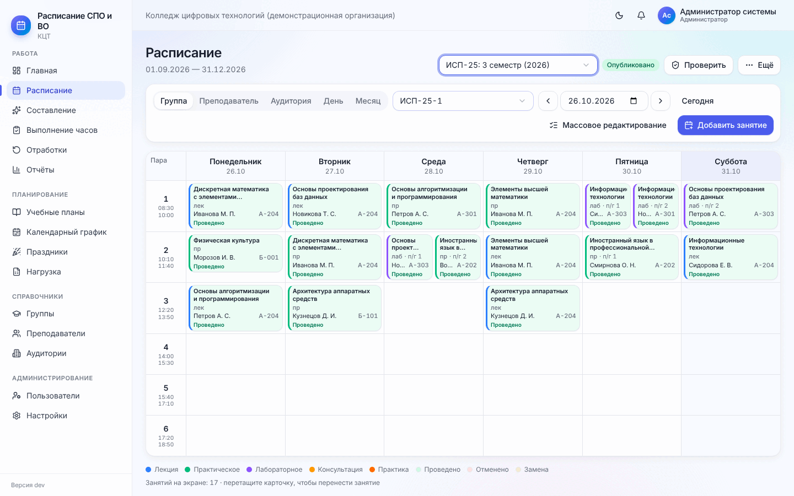
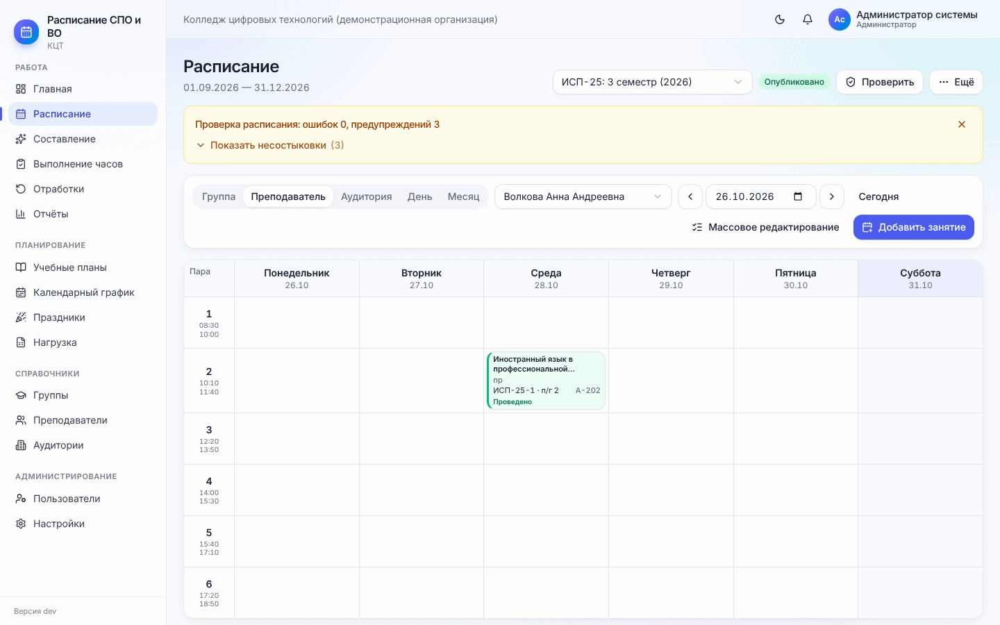
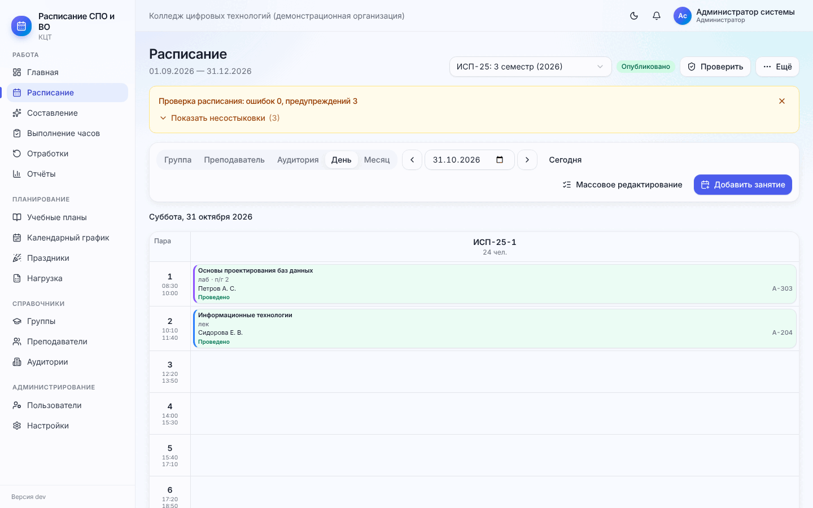
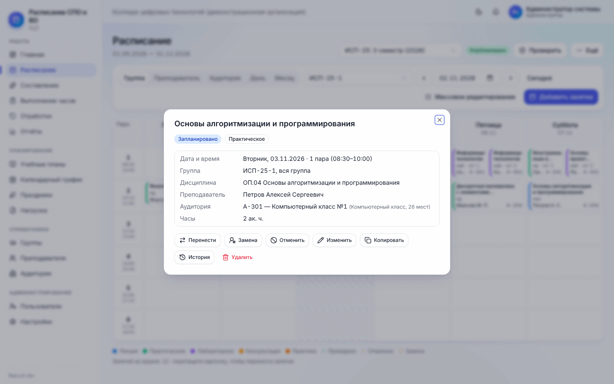
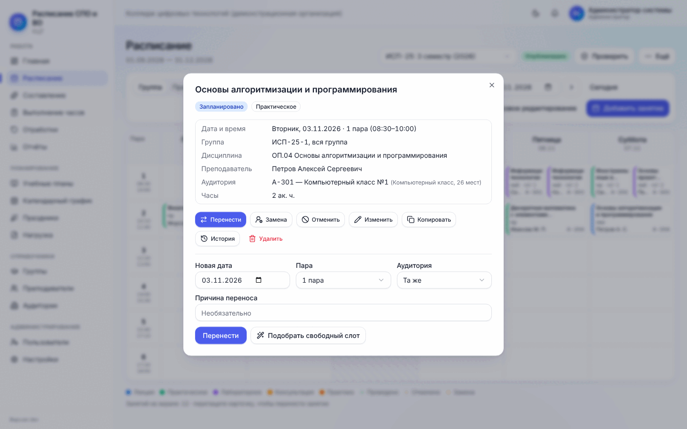
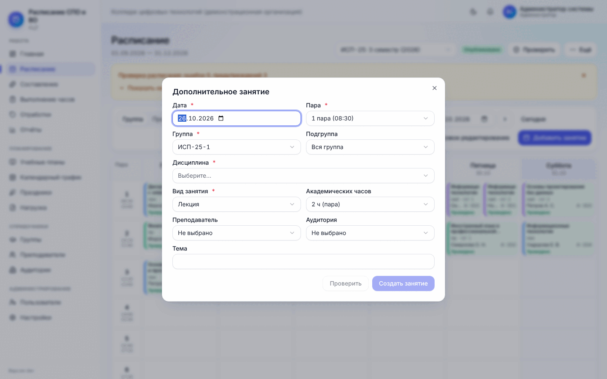
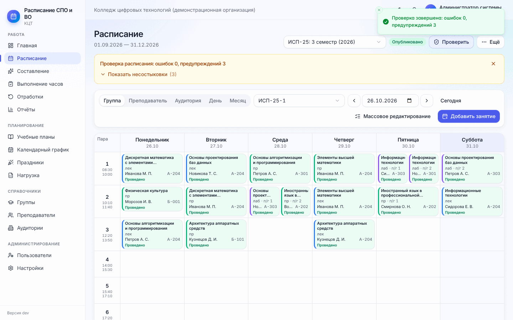
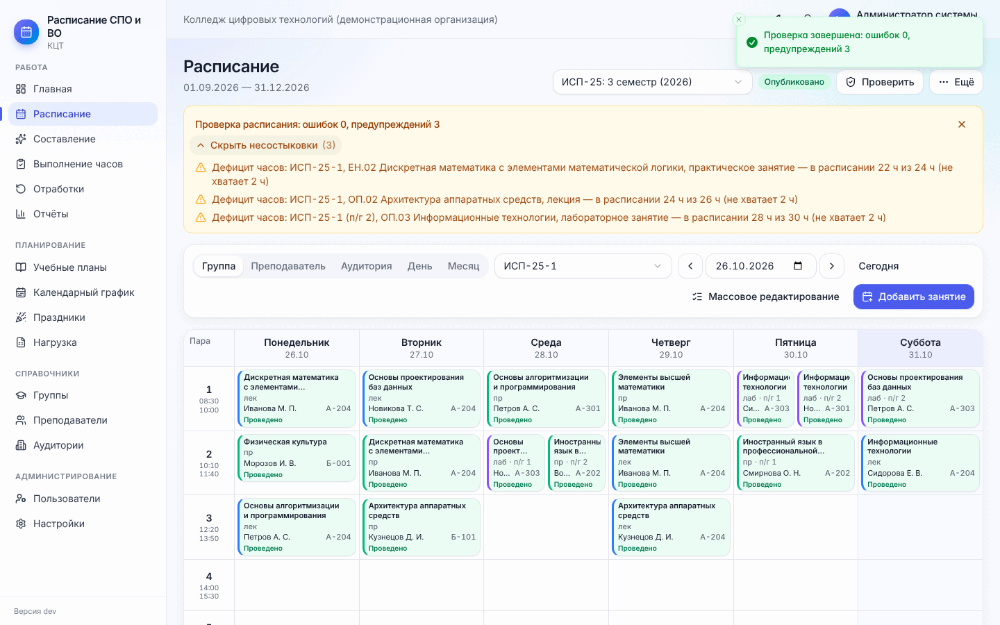
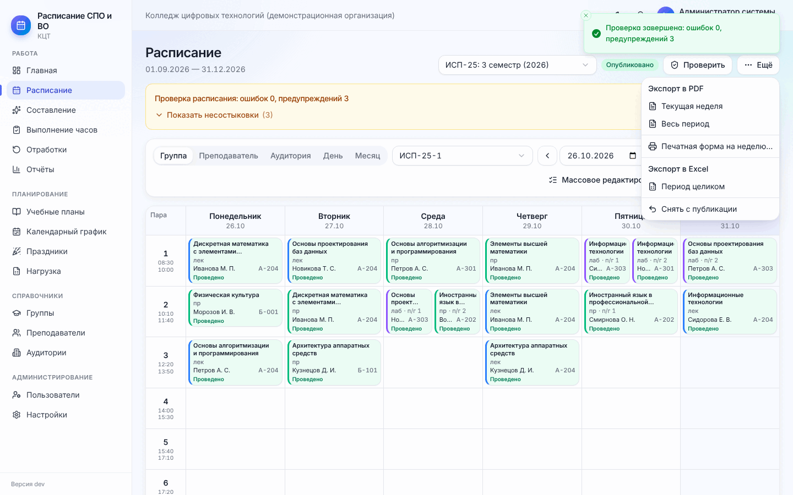
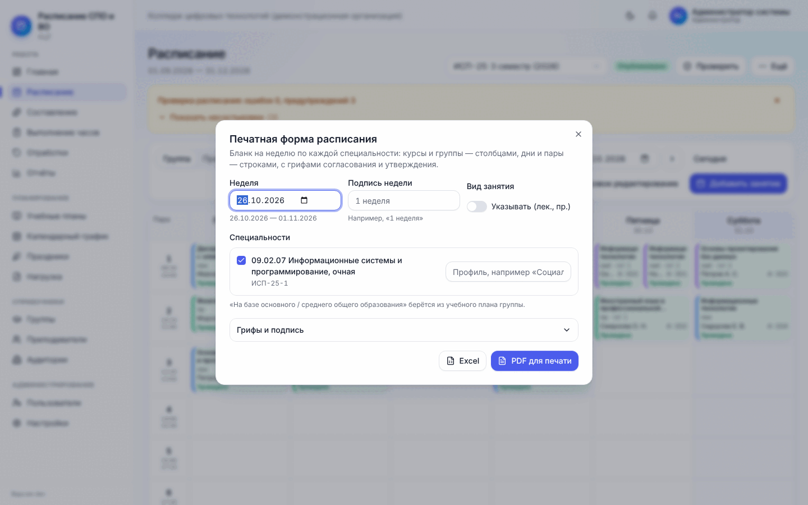

# 7. Работа с расписанием

[← 6. Составление](06-sostavlenie.md) · [Содержание](README.md) · [Далее: 8. Ежедневная работа →](08-ezhednevnaya-rabota.md)

**Меню → Расписание.** Здесь расписание просматривают, правят вручную, проверяют, публикуют и выгружают.

## 7.1. Шапка страницы

- **Выбор периода** (слева от кнопок) — расписание какого семестра какого плана открыто;
- **статус**: «Черновик» или «Опубликовано»;
- **«Проверить»** — полная проверка периода ([7.4](#74-проверка-и-устранение-конфликтов));
- **«Опубликовать»** — только у черновика ([7.5](#75-публикация));
- **«Ещё»** — PDF, печатная форма, Excel, снятие с публикации ([7.6](#76-печать-и-выгрузка)).

## 7.2. Виды и навигация

Переключатель видов:

| Вид | Что показывает |
| --- | --- |
| **Группа** | Неделя одной группы: пары × дни |
| **Преподаватель** | Неделя преподавателя по всем группам и планам |
| **Аудитория** | Занятость аудитории |
| **День** | Все группы в один день: столбцы — группы. Удобно для диспетчерской |
| **Месяц** | Календарь месяца со всеми занятиями |

Рядом — выбор группы / преподавателя / аудитории, стрелки **«Назад / Вперёд»** по неделям, поле даты и
**«Сегодня»**.

**Карточка занятия** в сетке: дисциплина, вид (лек, пр, лаб…; цвет полоски слева тоже означает вид), подгруппа
(«п/г 1»), преподаватель, аудитория, статус («Проведено», «Отменено»). Метки: **«1 ч»** — неполная пара,
значок стрелок — перенос/отработка, значок человека — замена, замок — закреплено. Под сеткой — легенда цветов и
число занятий на экране. Серым заштрихованы дни, когда занятий быть не может (праздники, каникулы).

## 7.3. Ручные правки

**Перенос перетаскиванием.** Возьмите карточку и перетащите в другую ячейку. Программа сразу проверит, свободны ли
группа, преподаватель и аудитория. Если есть конфликт, появится список конфликтов: отмените действие или (только
администратор и диспетчер) выберите **«Сохранить несмотря на конфликты»** — такое занятие проверка потом покажет
ошибкой, и опубликовать расписание не получится, пока его не исправят.

**Действия с занятием.** Нажмите на карточку:

| Кнопка | Что делает |
| --- | --- |
| Отметить проведение | Для прошедших и сегодняшних занятий ([8.1](08-ezhednevnaya-rabota.md#81-отметка-проведения)) |
| Перенести | Новая дата, пара, аудитория, причина; **«Подобрать свободный слот»** ищет время, где свободны все ([8.2](08-ezhednevnaya-rabota.md#82-перенос-занятия)) |
| Замена | Другой преподаватель на это занятие ([8.3](08-ezhednevnaya-rabota.md#83-замена-преподавателя)) |
| Отменить | С причиной; создаётся задача отработки ([8.4](08-ezhednevnaya-rabota.md#84-отмена-и-отработка)) |
| Изменить | Аудитория, преподаватель, часы (2 ч — пара, 1 ч — неполная), тема, примечание, «закреплено» |
| Копировать | Создать такое же занятие в другой день |
| История | Кто и когда создавал, переносил, заменял; цепочка переносов |
| Удалить | Удалить занятие. В опубликованном расписании студенты получат уведомление |

**Закреплённое** занятие генератор не трогает при пересоставлении — закрепляйте пары, которые расставили вручную
и не хотите потерять.

**Добавить занятие.** Кнопка **«Добавить занятие»** или нажатие на пустую ячейку. Укажите дату, пару, группу,
подгруппу, дисциплину, вид занятия, часы (пара или неполная пара), преподавателя, аудиторию, тему. Внизу формы
сразу видно «Конфликтов не обнаружено» или список конфликтов и предупреждений — ещё до сохранения.

**Массовое редактирование.** Нажмите **«Массовое редактирование»** — на карточках появятся галочки. Отметьте
нужные занятия; внизу появится панель «выбрано: N» с действиями: сменить аудиторию, сменить преподавателя,
закрепить, удалить. Каждое изменение тоже проверяется на конфликты.

## 7.4. Проверка и устранение конфликтов

Нажмите **«Проверить»**. Над сеткой появится итог «Проверка расписания: ошибок N, предупреждений M». Сам
список несостыковок свёрнут, чтобы не загораживать сетку: нажмите **«Показать несостыковки (N)»**, чтобы его
раскрыть, и «Скрыть несостыковки» — чтобы свернуть.

**Ошибки** (красные) **блокируют публикацию**:

- накладки: группа, преподаватель или аудитория заняты дважды в одно время;
- вместимость аудитории меньше группы; неподходящий тип аудитории;
- преподаватель или аудитория недоступны (сетка, правила, отпуск, вне периода работы);
- занятие в каникулы, практику, праздник, вне семестра или периода;
- нет преподавателя или аудитории; преподаватель не может вести у этого уровня;
- часов в расписании больше, чем по плану (без разрешения превышения).

**Предупреждения** (жёлтые) публикацию не блокируют: дефицит часов, неполная пара, перегрузка группы или
преподавателя, окна сверх допустимого, поздние пары, неравномерное распределение, мало учебных недель, много
экзаменов в неделю, занятие должно быть онлайн, а стоит в обычной аудитории.

Если есть ошибки, нажмите **«Как исправить»** — откроется окно **«Устранение конфликтов»**. Для каждой ошибки
программа предлагает готовые варианты: перенести в свободный слот, поставить другую свободную аудиторию,
заменить преподавателя, удалить дубль. Каждый вариант заранее проверен и не создаёт новых конфликтов —
применяется одним нажатием. **«Исправить всё автоматически»** по очереди применяет первый подходящий вариант к
каждой ошибке и повторяет проверку. Что не удалось исправить, останется в списке — это правится вручную.

Крестик справа скрывает панель проверки до следующей проверки (даже если есть ошибки). Если ошибки нашлись
в уже опубликованном периоде, программа пишет «расписание уже опубликовано, исправьте ошибки»: студенты видят
расписание, но эти места нужно поправить.

## 7.5. Публикация

Когда ошибок нет, нажмите **«Опубликовать»**. Студенты и преподаватели получат уведомление и увидят расписание у
себя («Моё расписание», главная). После публикации любые изменения (перенос, замена, отмена, удаление) сразу
видны участникам и приходят им в уведомлениях.

**«Ещё» → «Снять с публикации»** — расписание снова станет черновиком и пропадёт у студентов и преподавателей.

## 7.6. Печать и выгрузка

Меню **«Ещё»**:

- **Экспорт в PDF** — «Текущая неделя» или «Весь период» для того, что сейчас на экране (группа, преподаватель,
  аудитория);
- **Печатная форма на неделю…** — официальный бланк колледжа;
- **Экспорт в Excel** — «Период целиком»;
- **Снять с публикации**.

**Печатная форма** — бланк на неделю по каждой специальности: курсы и группы — столбцами, дни и пары — строками,
с грифами «УТВЕРЖДАЮ» и подписью.

1. Выберите **неделю** и при желании **подпись недели** («1 неделя»).
2. **«Вид занятия»** — показывать ли (лек., пр.) рядом с дисциплиной.
3. Отметьте **специальности**, для каждой можно указать профиль («Социально-экономический»). Строка «на базе
   основного / среднего общего образования» берётся из учебного плана (поле «База приёма»).
4. **«Грифы и подпись»** — должность и ФИО утверждающего («И.о. директора филиала»), гриф «ВНЕСЕНО», подпись
   внизу. Можно убрать гриф.
5. **«PDF для печати»** или **«Excel»** (если нужно поправить вручную).

Если написано «На этой неделе занятий нет» — выберите другую неделю или опубликуйте расписание.

PDF расписания отдельного преподавателя или группы есть также в их карточках («PDF расписания»).

[← 6. Составление](06-sostavlenie.md) · [Содержание](README.md) · [Далее: 8. Ежедневная работа →](08-ezhednevnaya-rabota.md)
