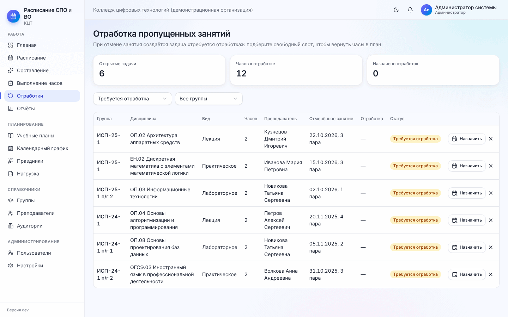

# 8. Ежедневная работа

[← 7. Работа с расписанием](07-raspisanie.md) · [Содержание](README.md) · [Далее: 9. Контроль часов и отчёты →](09-kontrol-i-otchyoty.md)

После публикации расписание «живёт»: занятия проводятся, переносятся, кто-то болеет. Все действия ниже
выполняются из карточки занятия (нажмите на занятие в «Расписании», в карточке группы или преподавателя).
Диспетчер и администратор могут это делать с любым занятием, **преподаватель — со своими**. Каждое действие
записывается в журнал, участникам приходит уведомление.

## 8.1. Отметка проведения

Кнопка **«Отметить проведение»** есть у сегодняшних и прошедших занятий. Варианты:

| Отметка | Когда | Как считаются часы |
| --- | --- | --- |
| Проведено полностью | Обычный случай | «Проведено» += часы занятия |
| Проведено частично | Например, 1 час из 2 | Засчитываются фактические часы (поле «Фактически проведено, ак. часов»), недостающие видны как дефицит |
| Проведено заменяющим | Вёл другой преподаватель | Укажите заменяющего; часы засчитываются ему |
| Не состоялось | Пара сорвалась | Занятие отменяется, создаётся задача отработки ([8.4](#84-отмена-и-отработка)) |

Можно записать тему занятия. Ошибочную отметку снимает кнопка **«Снять отметку»** — часы вернутся в остаток.

Если в настройках включено **«Засчитывать проведённые пары автоматически»**, неотмеченные пары опубликованного
расписания после окончания считаются проведёнными. Без этой настройки неотмеченные прошедшие пары видны на
главной у преподавателя («Требуется отметить проведение») и в контроле часов как «Не отмечено».

## 8.2. Перенос занятия

**«Перенести»** → новая дата, пара, аудитория («Та же» или другая), причина. Удобнее всего нажать
**«Подобрать свободный слот»**: программа покажет даты и пары, где одновременно свободны группа (подгруппа),
преподаватель и подходящая аудитория, с учётом календарного графика и доступности. Слоты отсортированы: сначала
ближайшие к исходной дате, без окон и перегрузки дня. Выберите слот → «Перенести».

В опубликованном расписании исходное занятие остаётся в истории со статусом «Перенесено», а новое помечено
значком переноса. Часы считаются один раз.

Перетаскивание карточки в сетке ([7.3](07-raspisanie.md#73-ручные-правки)) — то же самое, только быстрее.
Пара потока (несколько групп) переносится целиком.

## 8.3. Замена преподавателя

**«Замена»** → заменяющий преподаватель и причина («болезнь, командировка…»). Программа проверит, что заменяющий
свободен и может вести у этого уровня. Часы дисциплины группы не меняются, а факт проведения засчитывается
заменяющему. На карточке появится значок замены, в отчётах — строка в «Заменах преподавателей».

## 8.4. Отмена и отработка

**«Отменить»** → причина (отсутствие группы, отсутствие преподавателя, аудитория недоступна, нерабочий день,
иная) и комментарий. Часы отменённого занятия **не списываются**: они остаются в остатке по дисциплине, и
создаётся задача **«Требуется отработка»**. Сразу показываются свободные слоты для отработки.

**Меню → Отработки** — все такие задачи:

- вверху — открытые задачи, часы к отработке, назначено отработок;
- фильтры по статусу («Требуется отработка», «Назначена», «Проведена», «Не требуется») и группе;
- в строке: группа, дисциплина, вид, часы, преподаватель, отменённое занятие, отработка, статус.

**«Назначить»** → список свободных слотов → выберите слот. Отработка ставится в расписание («Отработка
поставлена в расписание») и связывается с отменённым занятием. Если слотов нет — расширьте диапазон дат или
освободите время преподавателя. При конфликте диспетчер может «Назначить несмотря на конфликты».

Кнопка **закрытия** в конце строки — «Закрыть задачу без отработки?» (например, часы компенсированы иначе). Тогда часы останутся в
дефиците.

## 8.5. Отпуск, больничный, курсы преподавателя

**Карточка преподавателя → «Ограничения» → «Отпуск, курсы, больничный» → «+ Отпуск, курсы, больничный».**

1. Причина: отпуск, курсы повышения квалификации, больничный, командировка.
2. Даты «с … по …».
3. Галочка **«Перенести пары, которые стоят в эти дни, на ближайшее время после выхода»** — программа сама
   переставит уже поставленные пары. Поле **«Сверх лимита, пар в неделю»** — насколько можно превысить недельный
   лимит преподавателя, пока пары не отработаны (например, 4).

В эти дни генератор не ставит преподавателю занятия, а проверка расписания покажет уже стоящие. Если галочку не
ставить, оформите замены ([8.3](#83-замена-преподавателя)) или отмены вручную.

## 8.6. Смена преподавателя в середине семестра

Преподаватель уволился или дисциплину передают другому с определённой даты:

1. **Карточка преподавателя → «Дисциплины» → «Передать»** у нужной дисциплины и группы.
2. Выберите **нового преподавателя** и **с какой даты**.
3. «Готово» — сообщение «Передано занятий: N».

Будущие занятия переходят к новому преподавателю, прошедшие остаются за прежним, плановые часы делятся между
ними. Если преподаватель уходит совсем, укажите в его карточке «Работает по» — после этой даты ему ничего не
поставится.

Если новый преподаватель пришёл, а занятий до этого не было вовсе (дисциплина «висела» без преподавателя),
назначьте его в нагрузке и запустите составление **«С даты»** ([6.5](06-sostavlenie.md#пересоставление-в-середине-семестра)) —
все часы распределятся по оставшимся неделям.

[← 7. Работа с расписанием](07-raspisanie.md) · [Содержание](README.md) · [Далее: 9. Контроль часов и отчёты →](09-kontrol-i-otchyoty.md)
