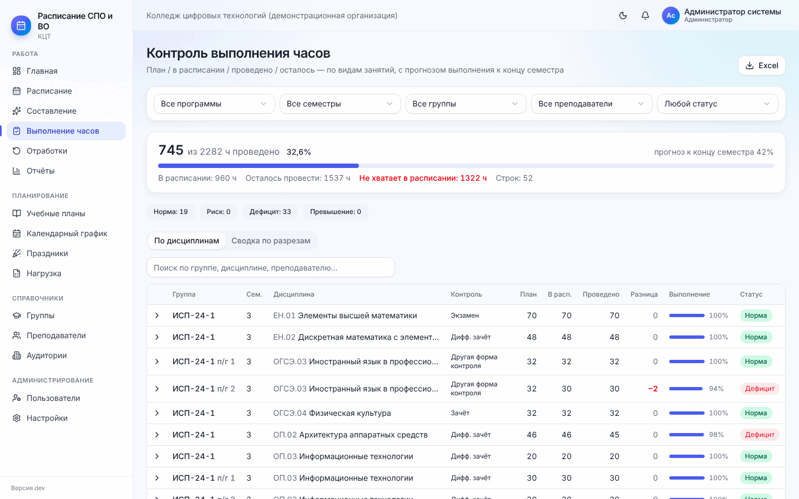
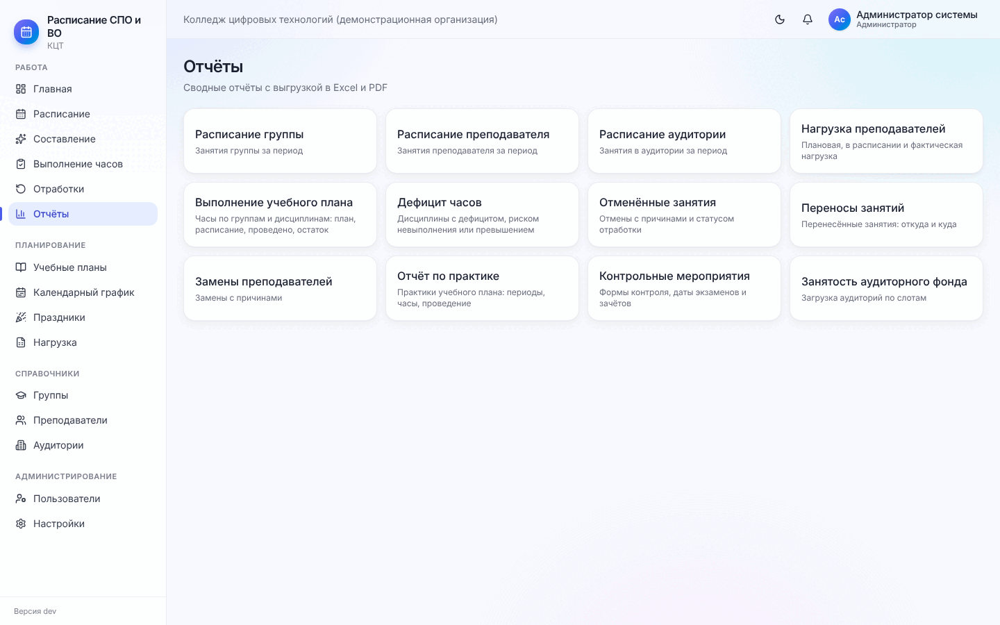
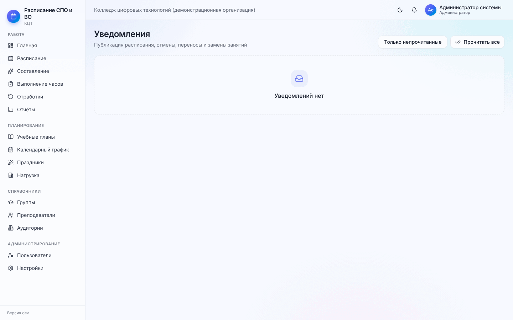

# 9. Контроль часов и отчёты

[← 8. Ежедневная работа](08-ezhednevnaya-rabota.md) · [Содержание](README.md) · [Далее: 10. Преподавателю и студенту →](10-prepodavatelyu-i-studentu.md)

## 9.1. Как считаются часы

По каждой дисциплине группы (и каждому виду занятий, подгруппе) программа ведёт четыре числа:

| Показатель | Что это |
| --- | --- |
| **План** | Часы из учебного плана на семестр |
| **В расписании** | Сумма часов поставленных занятий (запланированных, проведённых, с заменой). Отменённые и перенесённые-исходные не считаются |
| **Проведено** | Сумма часов с отметкой «проведено» (частичное — фактическими часами) |
| **Осталось** | План − проведено |

Из них выводятся **дефицит** (в расписании меньше плана), **превышение** (больше плана), **прогноз** к концу
семестра (проведено + будущие + неотмеченные) и **статус**:

| Статус | Когда |
| --- | --- |
| Норма | Всё идёт по плану |
| Риск | Часы расставлены, но много прошедших занятий не отмечено или факт отстаёт от ожидаемого к сегодняшнему дню |
| Дефицит | В расписании не хватает часов или прогноз ниже плана |
| Превышение | В расписании больше часов, чем по плану (если превышение разрешено — отмечается как разрешённое) |

Пример: 35 часов = 17 полных пар + 1 неполная пара (1 час). Часы не теряются.

## 9.2. Выполнение часов

**Меню → Выполнение часов.**

1. **Фильтры**: программа, семестр, группа, преподаватель, статус.
2. **Сводка**: «745 из 2282 ч проведено», прогноз к концу семестра, в расписании, осталось провести, **не хватает
   в расписании** (красным), число строк.
3. **Плашки статусов** «Норма / Риск / Дефицит / Превышение» — нажмите, чтобы оставить только такие строки.
4. Вкладка **«По дисциплинам»**: строка = группа (подгруппа) × дисциплина: контроль, план, в расписании,
   проведено, **разница** (−2 — дефицит красным, +2 — превышение фиолетовым), выполнение в %, статус. Стрелка
   слева раскрывает виды занятий: преподаватель, будущие, не отмечено, отменено, прогноз.
5. Вкладка **«Сводка по разрезам»**: те же часы по группам, дисциплинам, преподавателям, семестрам, программам,
   СПО / ВО и организации в целом — с графиком.
6. **«Excel»** — выгрузить текущий вид.

Что делать с дефицитом: если «В расписании» меньше плана — дособерите расписание (составление «С даты» или
ручное добавление занятия); если меньше «Проведено» — проверьте неотмеченные и отменённые занятия, поставьте
отработки.

Те же данные есть в карточке группы («Выполнение часов»), преподавателя и учебного плана (кнопка «Выполнение
часов» — Excel по плану).

## 9.3. Отчёты

**Меню → Отчёты.** Двенадцать отчётов; у каждого свои параметры (период «с даты — по дату», учебный план,
семестр, группа, преподаватель, аудитория). Результат — таблица на экране и выгрузка в **Excel** и **PDF**.

| Отчёт | Для чего |
| --- | --- |
| Расписание группы / преподавателя / аудитории | Расписание за период в виде списка |
| Нагрузка преподавателей | План, в расписании, проведено по каждому преподавателю |
| Выполнение учебного плана | Часы по дисциплинам и группам |
| Дефицит часов | Где не хватает часов |
| Отменённые занятия | С причинами |
| Переносы занятий | Откуда и куда перенесено |
| Замены преподавателей | Кто кого заменял, сколько часов |
| Отчёт по практике | Практики групп |
| Контрольные мероприятия | Экзамены и зачёты: даты, пары, аудитории |
| Занятость аудиторного фонда | Загрузка аудиторий |

Преподавателю доступен отчёт по своему расписанию.

## 9.4. Уведомления

Колокольчик вверху и **Меню → Уведомления**: публикация расписания, новые занятия, изменения, отмены, переносы,
замены. Фильтр «Только непрочитанные», кнопка «Прочитать все». Уведомления получают те, кого изменение касается:
группа и преподаватели занятия.

## 9.5. Главная как панель контроля

Для руководителя удобнее всего главная страница ([1.5](01-znakomstvo.md#15-главная-страница)): выполнение плана
и прогноз, дисциплины с отставанием, перегрузка преподавателей, отмены за ±30 дней и часы к отработке — каждая
плашка ведёт в подробный раздел.

[← 8. Ежедневная работа](08-ezhednevnaya-rabota.md) · [Содержание](README.md) · [Далее: 10. Преподавателю и студенту →](10-prepodavatelyu-i-studentu.md)
