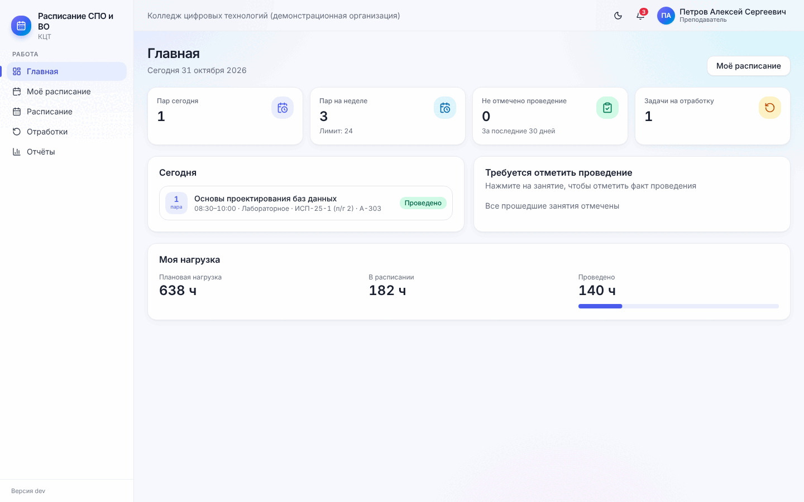
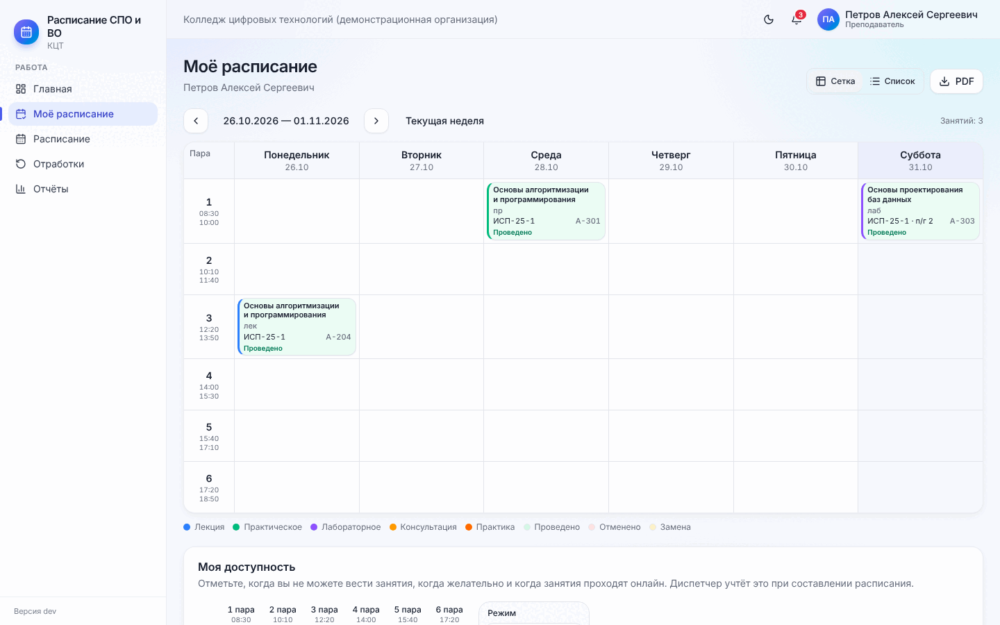
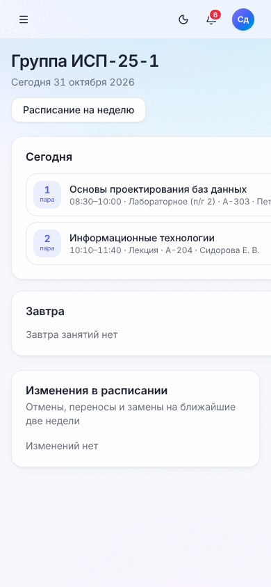
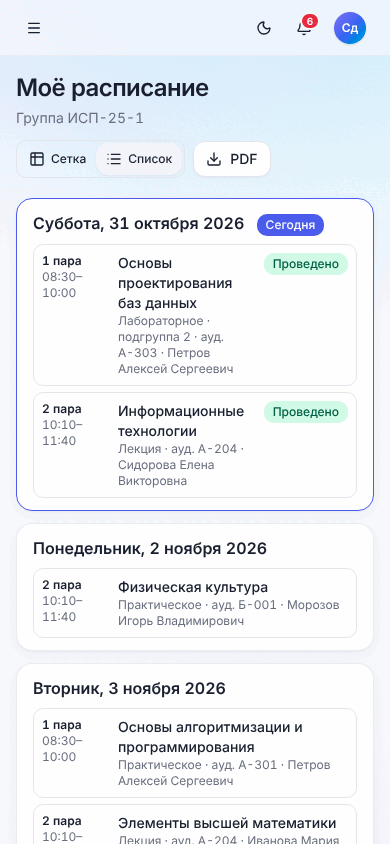

# 10. Преподавателю и студенту

[← 9. Контроль часов и отчёты](09-kontrol-i-otchyoty.md) · [Содержание](README.md) · [Далее: 11. Частые вопросы →](11-voprosy.md)

Этот раздел можно распечатать и раздать преподавателям и старостам.

## 10.1. Как войти

Логин (e-mail) и пароль выдаёт администратор. Программа открывается в любом браузере, в том числе на телефоне —
удобно добавить страницу на главный экран. Если после входа написано «Учётная запись не связана с расписанием»,
попросите администратора связать вашу учётную запись с карточкой преподавателя или с группой.

Расписание появляется после того, как диспетчер его **опубликует**. До этого на странице «Моё расписание»
написано «Расписание ещё не опубликовано».

## 10.2. Преподавателю

### Главная

- числа: пар сегодня, пар на неделе, **не отмечено проведение** (за последние 30 дней), задачи на отработку;
- **«Сегодня»** — ваши пары с группами и аудиториями;
- **«Требуется отметить проведение»** — прошедшие занятия без отметки. Нажмите на занятие, чтобы отметить;
- **«Моя нагрузка»** — плановая нагрузка, в расписании, проведено.

### Моё расписание

- переключатель **«Сетка / Список»**: сетка — неделя целиком, список — по дням (удобнее на телефоне);
- стрелки по неделям и «Текущая неделя»;
- **«PDF»** — скачать своё расписание;
- нажатие на занятие — карточка занятия с действиями.

**Что вы можете сделать со своим занятием:**

| Действие | Как |
| --- | --- |
| Отметить проведение | «Отметить проведение» → полностью / частично (сколько часов) / не состоялось; можно записать тему |
| Перенести | «Перенести» → «Подобрать свободный слот» → выбрать → «Перенести» |
| Оформить замену | «Замена» → коллега и причина |
| Отменить | «Отменить» → причина. Будет создана задача отработки |
| Поставить отработку | Меню → Отработки → «Назначить» → свободный слот |

Если в колледже включено автоматическое засчитывание, неотмеченные пары считаются проведёнными — отмечайте
только то, что прошло не так (частично, не состоялось, заменяли).

### Моя доступность

Внизу страницы «Моё расписание» — блок **«Моя доступность»**: отметьте, когда вы можете, не можете или хотели бы
вести занятия. Режимы «кисти»: доступно, желательно, нежелательно, недоступно (подробнее — в
[4.2](04-spravochniki.md#ограничения-преподавателя)). Диспетчер учтёт это при следующем составлении. Отпуск и
больничный сообщайте диспетчеру — он отметит их в вашей карточке.

### Отчёт

**Меню → Отчёты** — отчёт по вашему расписанию за выбранный период (Excel, PDF).

## 10.3. Студенту

Студенту доступны главная, «Моё расписание» и уведомления.

| Главная | Моё расписание |
| --- | --- |
|  |  |

- **Главная**: пары **сегодня** и **завтра**, **изменения в расписании** — отмены, переносы и замены на
  ближайшие две недели;
- **Моё расписание**: «Сетка» или «Список» по дням, **PDF**. У каждой пары — время, дисциплина, вид занятия,
  подгруппа, аудитория, преподаватель; «1 ак. ч (неполная пара)» — пара на один час;
- **колокольчик** — уведомления о публикации и изменениях.

[← 9. Контроль часов и отчёты](09-kontrol-i-otchyoty.md) · [Содержание](README.md) · [Далее: 11. Частые вопросы →](11-voprosy.md)
